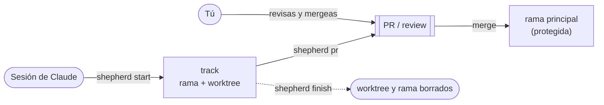

# claude-dotfiles

Configuración portable para Claude Code: slash commands y skills que quiero tener
disponibles en cualquier máquina o entorno donde use Claude Code.

Fuente de verdad para `~/.claude/commands/*.md`. Los archivos viven aquí (en git)
y se replican al directorio de usuario de Claude Code mediante scripts de instalación.

## Estructura

```
claude-dotfiles/
├── commands/                    # slash commands (resolver, autobuild, builds, shepherd, post, hs-*)
├── hackspain-starter/           # kit HackSpain 2026: scaffold Python + playbooks + cheat sheets
├── harnesses/
│   ├── autonomous-coding/       # harness de 3 agentes (se ejecuta in-place, no lo instala install.sh)
│   ├── eval-inspect/            # harness de evaluación formal de agentes con Inspect AI
│   ├── shepherd/                # tracks + reviews + dashboard para sesiones de Claude Code en paralelo
│   └── tools/                   # utilidades compartidas (harness.py CLI, repomap.py, init_project.py multi-IDE)
├── skills/                      # skills generales
│   ├── grilling/
│   ├── grill-me/
│   ├── writing-great-skills/
│   ├── writing-docs/            # documentación con base en el código + diagramas Mermaid verificados
│   ├── live-coding/             # bucle de live-coding con agente + patrones de cambios en apps con LLM
│   ├── agent-harness/           # check + hook de tests tras cada edición + permisos + CLAUDE.md
│   ├── diagnosing-bugs/
│   ├── tdd/
│   ├── prototype/
│   ├── domain-modeling/
│   ├── handoff/
│   ├── parallel-sessions/
│   ├── to-issues/
│   ├── code-review/
│   ├── roast-my-post/
│   └── impeccable/              # design fluency frontend (pbakaus/impeccable, Apache 2.0)
├── agents/                      # subagentes del plugin (impeccable-*)
├── hooks/hooks.json             # hooks del plugin (shepherd; inertes fuera de repos inscritos)
├── skills-amazon/               # skills internas Amazon — GITIGNORED, nunca commitear
│   ├── README.md
│   └── shepherd-*/              # backends de review privados de shepherd (no en git)
├── .claude-plugin/plugin.json   # manifiesto del plugin de skills
├── .gitignore                   # excluye skills-amazon/
├── install.ps1                  # instala en Windows
├── install.sh                   # instala en Linux/Mac (commands + plugin de skills)
└── README.md
```

### skills/ vs skills-amazon/

| Carpeta | ¿En el repo? | Contenido |
|---|---|---|
| `skills/` | Sí | Skills generales y de ingeniería (fuente: mattpocock/skills) + diseño frontend (fuente: pbakaus/impeccable) |
| `skills-amazon/` | No (gitignored) | Skills con referencias a sistemas internos Amazon |

El repo es **privado** desde el 8 de septiembre de 2026 (contiene material personal
en `hackspain-starter/playbooks/`). `skills-amazon/` sigue fuera de git igualmente.

## Instalación

### Windows (PowerShell)

```powershell
cd <ruta-del-repo>
./install.ps1
```

### Linux / macOS

```bash
cd <ruta-del-repo>
./install.sh
```

Ambos scripts son idempotentes: vuelves a ejecutarlos cuando hagas `git pull`
para sincronizar cambios.

## Uso desde otro entorno

```bash
git clone <url-del-repo> ~/claude-dotfiles
cd ~/claude-dotfiles
./install.sh   # o ./install.ps1 en Windows
```

## Slash commands disponibles

| Comando | Descripción |
|---|---|
| `/resolver` | Protocolo de resolución de problemas con IA: clasifica el tipo, ejecuta los 7 pasos con mapeo humano↔LLM, e incluye verificación adversarial contra sycophancy. |
| `/repomap` | Extrae y carga el mapa semántico de símbolos del repo (estilo Aider Repo-Map) para orientar al modelo sin saturar contexto. |
| `/architect` | Modo Arquitecto (pensar primero, editar después): diseña la solución, mapea dependencias y diffs conceptuales sin tocar ficheros hasta aprobación. |
| `/eval` | Evaluador adversarial en sesión: adopta el rol de Evaluator escéptico independiente para intentar refutar que el cambio funciona mediante pruebas reales. |
| `/autobuild` | Lanza el harness autónomo de 3 agentes (Planner / Generator / Evaluator) sobre una spec. |
| `/builds` | Dashboard de solo lectura de las sesiones del harness. |
| `/shepherd` | Abre el dashboard de shepherd (qué desarrolla cada sesión, su rama, su review, conflictos previstos) y resume lo accionable. `stop` / `doctor`. |
| `/post` | Bucle de contenido "Show Your Work" para LinkedIn/X sobre el vault de Obsidian. Un paso por invocación. |
| `/hs-frame` | HackSpain, hora 1: del texto del reto a un Framing Brief (one-liner, demo moment, tracer bullet, impacto, tracks). Sin código. |
| `/hs-demo` | HackSpain: guion de demo con golden path, pre-warm, escalera de fallback y reparto driver/narrador. |
| `/hs-pitch` | HackSpain: `draft` genera borrador EN + guion de entrega ES de 3 min con tiempos; `tighten` afina un guion pegado. |
| `/hs-judge` | HackSpain: Q&A simulado (`panel` rota personas VC/operador, `coffee` una pregunta abierta tipo FDE) puntuando el protocolo de 4 pasos. |
| `/hs-contact` | HackSpain: registra a una persona en `contacts.md` y redacta los follow-ups de 48h y 2 semanas. |
| `/hs-check` | HackSpain: `setup` copia las plantillas de coherencia (CONTRACT.md, AGENTS.md, check.sh, CI) al repo del proyecto; `review` pasa el check y revisa el diff contra el contrato. |

Los comandos `hs-*` leen su playbook en `hackspain-starter/playbooks/` antes de actuar; ver
`hackspain-starter/playbooks/README.md`. Están escritos en inglés.

## Skills disponibles

Las skills se instalan como plugin local (el repo es marketplace + plugin): `claude plugin marketplace add <repo>` y `claude plugin install claude-dotfiles@claude-dotfiles --scope user`. `install.sh` e `install.ps1` lo hacen automáticamente.

### Productividad

| Skill | Tipo | Descripción |
|---|---|---|
| `grilling` | model-invoked | Entrevista relentless sobre cada aspecto de un plan hasta resolver todas las decisiones. |
| `grill-me` | user-invoked | Lanza una sesión `/grilling`. |
| `handoff` | user-invoked | Compacta la conversación en un doc de continuidad para la próxima sesión. |
| `parallel-sessions` | model-invoked | Coordina varias sesiones de Claude Code en el mismo repo con shepherd: cada sesión reclama una track (rama + worktree + paths que posee), trabaja solo ahí y termina en una review; mensajes entre tracks por el log de shepherd. |
| `writing-great-skills` | user-invoked | Referencia para escribir y editar skills — vocabulario y principios de predictabilidad. |
| `roast-my-post` | user-invoked | Gallo/roaster de borradores (LinkedIn/social, ES o EN): puntúa cuánto suena a IA, destroza los tells citando tu texto, y lo reescribe con voz humana. |

### Ingeniería

| Skill | Tipo | Descripción |
|---|---|---|
| `diagnosing-bugs` | model-invoked | Loop estructurado de 6 fases para bugs difíciles: feedback loop → repro → hipótesis → instrumentar → fix → post-mortem. |
| `tdd` | model-invoked | Red-green-refactor loop. Referencia de qué es un buen test, seams, anti-patterns y reglas del loop. |
| `prototype` | model-invoked | Prototipo throwaway para responder una pregunta de diseño (rama lógica o rama UI). |
| `domain-modeling` | model-invoked | Construye y afina el modelo de dominio: desafía términos, captura CONTEXT.md y ADRs. |
| `to-issues` | user-invoked | Rompe un plan/PRD en issues independientes usando vertical slices (tracer bullets). |
| `code-review` | model-invoked | Review en dos ejes paralelos: Standards (smells + convenciones) y Spec (¿implementa lo pedido?). |
| `writing-docs` | model-invoked | Escribe o mejora documentación (READMEs, guías, arquitectura, referencia) con cada dato comprobado en el código y diagramas Mermaid que se renderizan en GitHub; `scripts/check_docs.py` renderiza cada diagrama con mermaid-cli y revisa los enlaces. |
| `live-coding` | model-invoked | Bucle de live-coding con un agente delante de público (entrevista, pairing): encuadre, plan, test en rojo, cambio mínimo, check, evidencia, commit pequeño. Incluye orientación en repos desconocidos y patrones para cambios en apps con LLM (tool, guardrail, eval, router, integraciones, MCP, A/B). |
| `agent-harness` | model-invoked | Deja un repo listo para agentes de código: un comando de check, un hook PostToolUse que ejecuta los tests tras cada edición (tolera el rojo de TDD), permisos y un `CLAUDE.md` con comandos, reglas, seams y gotchas. |

### Diseño frontend

| Skill | Tipo | Descripción |
|---|---|---|
| `impeccable` | ambos | [Impeccable](https://impeccable.style) v4.3.1 (Apache 2.0). Un skill con 24 sub-comandos: `/impeccable shape`, `audit`, `critique`, `polish`, `bolder`, `quieter`, `distill`, `harden`, `onboard`, `animate`, `colorize`, `delight`, `layout`, `typeset`, `adapt`, `clarify`, `optimize`, `overdrive`, `init`, `document`, `extract`, `live`, `generate`, `craft` (alias deprecado). Se auto-invoca en tareas de UI. |

Trae 4 subagentes en `agents/` (`impeccable-asset-producer`, `impeccable-documenter`,
`impeccable-finish-reviewer`, `impeccable-manual-edit-applier`). El launcher
`skills/impeccable/scripts/impeccable` descarga en el primer uso un binario a `~/.impeccable/bin/`
(sin Node). Los hooks PostToolUse/Stop del plugin original **no** están incluidos; ver
`skills/impeccable/reference/hooks.md` si los quieres.

Para actualizar: clonar `pbakaus/impeccable`, copiar `plugin/skills/impeccable` y `plugin/agents/`
encima, y revisar el diff.

Fuente: [mattpocock/skills](https://github.com/mattpocock/skills)

## shepherd — sesiones en paralelo, visibles y con review

`harnesses/shepherd/` (stdlib, Python 3.9+). Cada sesión de Claude Code trabaja en
una **track** —su rama, su worktree y los paths que posee— y su trabajo llega a la
rama principal solo por una review (PR en GitHub; otros hosts con un backend
privado). Un dashboard local (`/shepherd`) enseña qué desarrolla cada sesión.



- **Guía de uso** (inscribir un repo, el día a día, qué se bloquea, comandos,
  situaciones comunes): [harnesses/shepherd/README.md](harnesses/shepherd/README.md).
- **Cómo está hecho**: [docs/architecture.md](harnesses/shepherd/docs/architecture.md);
  **backends de review**: [docs/backends.md](harnesses/shepherd/docs/backends.md).
- **Lo que siguen los agentes**: la skill [`parallel-sessions`](skills/parallel-sessions/SKILL.md).
- **Backends privados en este repo**: las carpetas de `skills-amazon/*/` con `SKILL.md`
  se enlazan en `~/.claude/skills/` y ejecutan su `install.sh` desde `install.sh`, sin
  aparecer en `plugin.json`.

## Móvil / claude.ai web

Los slash commands de filesystem no aplican en claude.ai web/móvil.
Para llevar un comando a esos entornos: copiar el contenido del `.md`
(sin el frontmatter) como system prompt de un Project en claude.ai.
