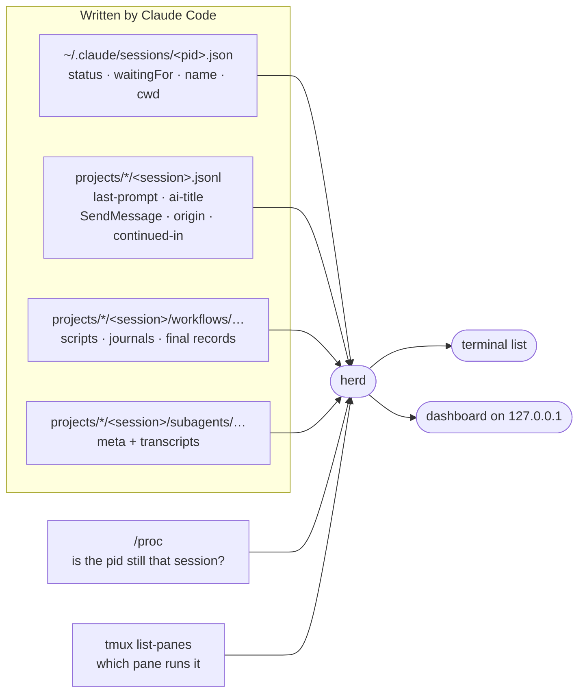

# herd

herd answers one question: **which of my Claude Code sessions needs me right now?** It lists every live session on the machine — blocked ones first, then the ones that finished their turn, then the ones still working — with what each was last asked and where it runs. `herd serve` shows the same thing as a local web dashboard, with each session's workflows and subagents underneath, and a graph view of what every session started and who messaged whom. It can also start sessions inside tmux so they survive a dropped SSH connection, and jump you into one.

It is the light sibling of [shepherd](../shepherd/README.md): no tracks, no reviews, no hooks and no daemon. It only reads what Claude Code already writes; the one thing it keeps is the dashboard's access token. Stdlib only, Python 3.9+, Linux.



## Install

```bash
ln -sfn ~/claude-dotfiles/harnesses/herd/herd.py ~/.local/bin/herd
mkdir -p ~/.config/tmux && ln -sfn ~/claude-dotfiles/harnesses/herd/tmux.conf ~/.config/tmux/tmux.conf
```

The second line is optional: [`tmux.conf`](tmux.conf) turns on mouse-wheel scrollback, keeps 50,000 lines per pane and passes Claude Code's 24-bit colour through. If you already keep a `~/.tmux.conf`, copy its three settings there instead. Run `tmux source-file ~/.config/tmux/tmux.conf` to apply it to a tmux server that is already running.

## Use

```bash
herd                          # the list (same as `herd ls`); --json for scripts
herd watch                    # redraw every 2 s (-n SECS); rings the bell when a session blocks
herd serve                    # dashboard on http://127.0.0.1:7798 (-p PORT)
herd new api ~/src/api        # start `claude --name api` in a detached tmux session `api`
herd new api ~/src/api -- --model opus   # everything after -- goes to claude
herd go api                   # attach to it (switch-client when already inside tmux)
```

```text
STATE     FOR  NAME                         DIR                      BRANCH           TMUX         LAST PROMPT
blocked    3m  api                          ~/src/api                fix-auth         api:0.0      dialog open
done      12m  Flaky test fix               ~/src/web                main             -            fix the flaky login test
working    1m  sca-serving-layer (bg)       ~                        -                -            continue
```

- **STATE** — `blocked` (a permission prompt, question or dialog is waiting on you; the last column shows Claude Code's own reason, such as `dialog open` or `input needed`), `done` (finished its turn, your move), `working`. Within a state, whoever has waited longest comes first.
- **FOR** — time since the session's status last changed.
- **NAME** — the session name; auto-derived names like `pablomv-6a` are replaced by the session's AI title. `(bg)` marks background sessions.
- **TMUX** — the pane running it, if any; `herd go` accepts a tmux session name, a session name or title, a pid or a session-id prefix.

## The dashboard

`herd serve` prints a URL like `http://127.0.0.1:7798/?t=<token>`; open it once and the token moves into a cookie. On a remote machine, forward the port first (VS Code: *Ports → Forward*, or `ssh -L 7798:localhost:7798 <host>`). To keep it running, start it in tmux: `tmux new -d -s herd-ui herd serve`.

The page answers three questions, in this order, without a click: does anything need me, and for what; what finished so I can read it; is the long-running work healthy. The header says it in one sentence (`1 needs you`, `1 waiting for your reply · 6 working`, `Nothing needs you`), and sessions come in four groups:

- **Needs you** — blocked sessions, longest wait first, with what they wait for and the tool call they want to run.
- **Your turn** — sessions that finished and you haven't opened yet, with the first line of their last reply. Opening one moves it to **Idle** until it finishes again.
- **Working** — one line per session, plus one line per live workflow: its name, the current phase (`Review, 2 of 4`), how many agents are running, a small phase strip, and a problem word (`1 stalled`, `2 failed`) only when an agent in the current or a later phase is in trouble. A working session that has written nothing for 10 minutes and runs nothing shows `quiet 14m`.
- **Idle** — finished sessions you have already seen.

Click a session (or `j`/`k` and Enter) to open it: folder and branch, a *Copy herd go* button when it runs in tmux, your last prompt, its last reply, each live workflow phase by phase with its unfinished agents and what they are doing, its subagents, and a fold with the workflows that finished in the last 24 h. Open rows, folds and focus survive the 2 s redraw, and a row under the pointer doesn't move.

Colour is kept for what needs you: red only for blocked sessions, amber only for stalled or failed work and quiet sessions. With nothing wrong the page is grey and still. The tab title counts what needs you (`(2) herd · host`), the favicon turns red while a session is blocked, and the footer offers browser notifications for sessions that block.

*Not in tmux* on a session means it was started in a plain terminal (a VS Code terminal, an SSH shell): herd can tell you its folder but `herd go` can't take you there, and it ends if that terminal closes. Sessions started with `herd new` run in tmux.

### The graph

**Graph** in the header (or `g`, or the URL `…/#graph`) switches to a second view of the same sessions: each one as the root of what it started, and who talked to whom.

```text
  ┌→ checkout-service refactor ───┬── ✓ contract-audit   40 agents · ended 1h ago
  │  Working                      ├── ✓ Explore  Map the payment flows
  │                               ├── ○ general-purpose  Implement the adapters · 4 messages
  │                               │     ├── ○ Explore  Find every call site
  │                               │     └── ✓ Explore  Check the old retries
  │                               └── ◍ refactor-verify  Review, 2 of 3 · 2 running · 1 stalled
  └→ docs site ────────────────────── ○ general-purpose  Regenerate the API reference
     Waiting for permission prompt
```

- **Spawns** are the outline: subagents and the ones they spawned, forks, and workflow runs. A run is one line (its readout, as in the list); open it (click, Enter or `→`) for its phases and agents.
- **Messages between sessions** (`SendMessage`) and **hand-offs to a background job** are arcs in the left margin, arrowheads at the receiving end; hover an arc for counts, times and the sender's summary. Messages between a session and its own subagent (its reports back, the session's follow-ups) are a count on the subagent's row.
- **History:** running work in full; finished agents, runs and messages from the last 24 h drawn muted, then gone. Per parent, the newest five finished children are drawn and the rest fold into `N more`; per workflow phase, six agents (trouble first). A session that has ended appears only while it is linked to a live one by a message or a hand-off.
- **Keys:** `j`/`k` or the arrows move through the outline, `→`/`←` open, close or go to the parent, Home/End, Enter opens a run or takes a session to the list (row open), Esc closes the run you're in, `g` goes back. The focused node's details (folder, times, model, what it's doing, its messages) sit in a bar at the bottom.
- Sessions keep their place (oldest first, never reordered by urgency) and the outline doesn't change shape under the pointer.

## How it decides

- A session is live when its pid exists **and** the process start time matches the `procStart` in its registry file — a crashed session leaves its file behind, and pids get reused.
- Spare pre-started background workers and daemon processes are left out.
- The last prompt and title come from the bookkeeping records Claude Code re-appends to the end of each transcript, so herd reads only the tail of the file.
- A workflow's name and phases come from its script (`workflows/scripts/<name>-<run>.js`), its agents from the run's journal (`started` / `result` / `failed`), and its outcome from the final record Claude Code writes when the run ends (`completed`, `killed`…). A run with no final record is **running** while its journal or an agent transcript was written in the last 15 minutes, **stalled** after that.
- An agent is **done** when its transcript ends in a final answer or a `SubagentHandback`, **stopped** when the user interrupted it, **stalled** when it has been silent for 15 minutes. An agent that was retried under the same label and phase counts as *retried*, not stalled.
- A run with no final record whose last write is older than its session's process start died with the previous process: it is **interrupted**, not stalled. A run resumed from it gets its name and phases back from the session's Workflow tool calls, and the old run is hidden as superseded.
- A session parked into a background job leaves its interactive registry entry behind; herd shows the job only.
- **Graph links are exact joins, never guesses by name** (names are reused and renamed): a message is drawn when the sender's `SendMessage` result carries the same `msg_id` as the receiver's `origin` (or, with the sender's transcript missing, the receiver verified the live sender process); a subagent's report back is `origin.handback`; a follow-up is a `SendMessage` to the agent's id; a hand-off is the `continued-in` record. Nested subagents come from `parentAgentId`, forks from `isFork`, and an agent's start from its transcript's first record (its meta file is rewritten later).
- A background job's transcript and folder begin as a copy of the session it came from, record ids included: every event and agent is counted once, in the session that began first. A task notification corrects an agent that looks unfinished on disk.
- Transcripts are read incrementally: each poll reads only what was appended since the last one.
- `herd new` unsets the calling session's identity variables (`CLAUDECODE`, `CLAUDE_CODE_SESSION_ID`, the messaging socket…) so a session started from inside another doesn't inherit it.
- The dashboard listens on 127.0.0.1 only, answers only requests whose `Host` is local (no DNS rebinding), and needs the token kept in `~/.config/herd/token` (mode 0600) — the page shows your prompts.

## Limits

- The session registry, workflow journals and transcripts are undocumented Claude Code files (written against CLI 2.1.294–2.1.295). If a release changes them, `sessions()`, `workflows()`, `subagents()` and, for the graph, `_interaction()` in `herd.py` are the places to fix. A record herd can't read means a missing edge, never an error.
- Sessions on other machines don't show up, nor do messages to them; run herd on each machine (over SSH it works as is).
- The graph's first load reads each transcript written in the last 24 h once (well under a second here); after that it reads only new bytes.
- Child sessions started with `claude -p` from a Bash call aren't linked to their parent: nothing on disk records the link.
- `herd go` only reaches sessions running in tmux; others show their directory so you can find the terminal.
- A workflow whose script wasn't kept and whose launch can't be found shows as *Unnamed workflow*, with no phase total until its agents start.

## Tests

```bash
python3 -m unittest discover -s harnesses/herd/tests -t harnesses/herd/tests
```

They use a fake Claude config dir (`CLAUDE_CONFIG_DIR`), fake sessions and workflow runs, a dashboard on a random port and a private tmux server (`TMUX_TMPDIR`), so they never touch your real sessions.
