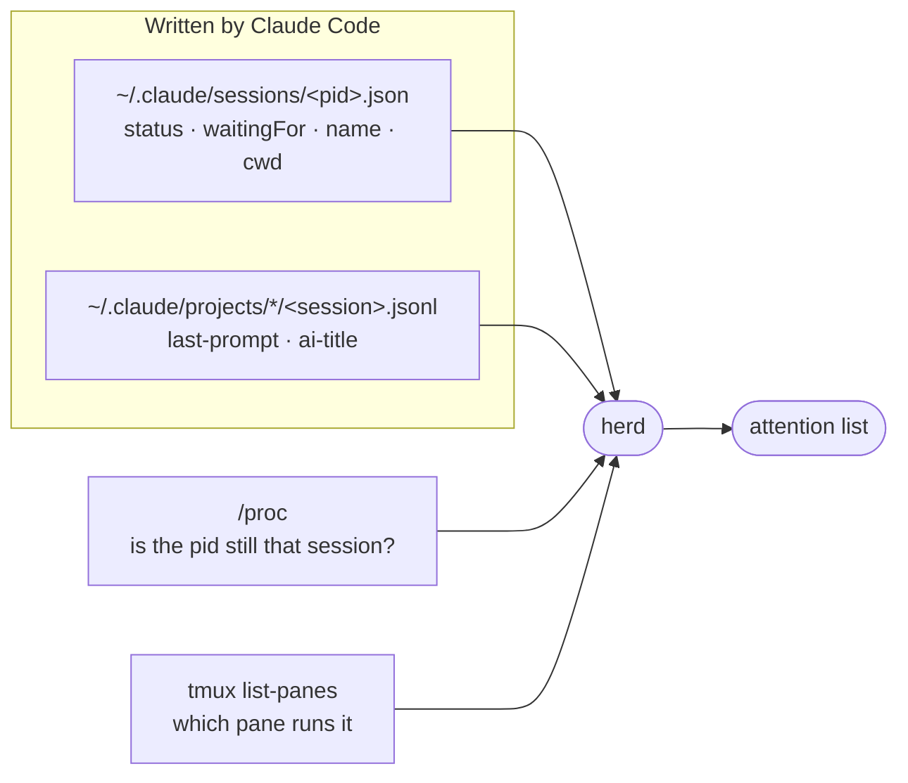

# herd

herd answers one question: **which of my Claude Code sessions needs me right now?** It lists every live session on the machine — blocked ones first, then the ones that finished their turn, then the ones still working — with what each was last asked and where it runs. It can also start sessions inside tmux so they survive a dropped SSH connection, and jump you into one.

It is the light sibling of [shepherd](../shepherd/README.md): no tracks, no reviews, no hooks, no daemon and no state of its own. It only reads what Claude Code already writes. One file, stdlib only, Python 3.9+, Linux.



## Install

```bash
ln -sfn ~/claude-dotfiles/harnesses/herd/herd.py ~/.local/bin/herd
```

## Use

```bash
herd                          # the list (same as `herd ls`); --json for scripts
herd watch                    # redraw every 2 s (-n SECS); rings the bell when a session blocks
herd new api ~/src/api        # start `claude --name api` in a detached tmux session `api`
herd new api ~/src/api -- --model opus   # everything after -- goes to claude
herd go api                   # attach to it (switch-client when already inside tmux)
```

```text
STATE     FOR  NAME                         DIR                      BRANCH           TMUX         LAST PROMPT
blocked    3m  api                          ~/src/api                fix-auth         api:0.0      dialog open
done      12m  Flaky test fix               ~/src/web                main             -            fix the flaky login test
working    1m  sca-serving-layer (bg)       ~                        -                -            continue
```

- **STATE** — `blocked` (a permission prompt, question or dialog is waiting on you; the last column shows Claude Code's own reason, such as `dialog open` or `input needed`), `done` (finished its turn, your move), `working`. Within a state, whoever has waited longest comes first.
- **FOR** — time since the session's status last changed.
- **NAME** — the session name; auto-derived names like `pablomv-6a` are replaced by the session's AI title. `(bg)` marks background sessions.
- **TMUX** — the pane running it, if any; `herd go` accepts a tmux session name, a session name or title, a pid or a session-id prefix.

## How it decides

- A session is live when its pid exists **and** the process start time matches the `procStart` in its registry file — a crashed session leaves its file behind, and pids get reused.
- Spare pre-started background workers and daemon processes are left out.
- The last prompt and title come from the bookkeeping records Claude Code re-appends to the end of each transcript, so herd reads only the tail of the file.
- `herd new` unsets the calling session's identity variables (`CLAUDECODE`, `CLAUDE_CODE_SESSION_ID`, the messaging socket…) so a session started from inside another doesn't inherit it.

## Limits

- The session registry is an undocumented Claude Code file (written against CLI 2.1.294). If a release changes it, `sessions()` in `herd.py` is the one place to fix.
- Sessions on other machines don't show up; run herd on each machine (over SSH it works as is).
- `herd go` only reaches sessions running in tmux; others show their directory so you can find the terminal.

## Tests

```bash
python3 -m unittest discover -s harnesses/herd/tests -t harnesses/herd/tests
```

They use a fake Claude config dir (`CLAUDE_CONFIG_DIR`), fake sessions and a private tmux server (`TMUX_TMPDIR`), so they never touch your real sessions.
