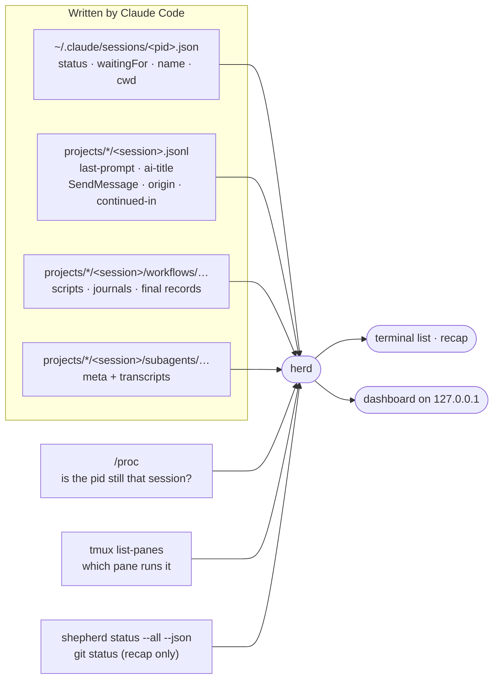

# herd

herd answers one question: **which of my Claude Code sessions needs me right now?** It lists every live session on the machine — blocked ones first, then the ones that finished their turn, then the ones still working — with what each was last asked and where it runs. `herd serve` shows the same thing as a local web dashboard, with each session's workflows and subagents underneath, and a graph view of what every session started and who messaged whom. `herd recap` answers the morning question, **what did I leave open?**, for sessions that have ended too. It can also start sessions inside tmux so they survive a dropped SSH connection, and jump you into one.

It is the light sibling of [shepherd](../shepherd/README.md): no tracks, no reviews, no hooks and no daemon. It only reads what Claude Code already writes (and, for the recap, what shepherd and `git status` report); all it keeps is the dashboard's access token and the recap skill's last summary. Stdlib only, Python 3.9+, Linux.



## Install

```bash
ln -sfn ~/claude-dotfiles/harnesses/herd/herd.py ~/.local/bin/herd
mkdir -p ~/.config/tmux && ln -sfn ~/claude-dotfiles/harnesses/herd/tmux.conf ~/.config/tmux/tmux.conf
```

The second line is optional: [`tmux.conf`](tmux.conf) turns on mouse-wheel scrollback, keeps 50,000 lines per pane and passes Claude Code's 24-bit colour through. If you already keep a `~/.tmux.conf`, copy its three settings there instead. Run `tmux source-file ~/.config/tmux/tmux.conf` to apply it to a tmux server that is already running.

## Use

```bash
herd                          # the list (same as `herd ls`); --json for scripts
herd watch                    # redraw every 2 s (-n SECS); rings the bell when a session blocks
herd serve                    # dashboard on http://127.0.0.1:7798 (-p PORT); already running: prints its URL
herd url                      # the dashboard's URL with its token, and the ssh line to reach it from a laptop
herd recap                    # what you left open since your last workday (or: friday, yesterday, 2d, 2026-10-09)
herd resume 7b2d4e61          # back into a session, even an ended one: claude --resume in a new tmux session
herd new api ~/src/api        # start `claude --name api` in a detached tmux session `api`
herd new api ~/src/api -- --model opus   # everything after -- goes to claude
herd go api                   # attach to it (switch-client when already inside tmux)
```

```text
STATE     FOR  NAME                         DIR                      BRANCH           TMUX         LAST PROMPT
blocked    3m  api                          ~/src/api                fix-auth         api:0.0      dialog open
done      12m  Flaky test fix               ~/src/web                main             -            fix the flaky login test
working    1m  sca-serving-layer (bg)       ~                        -                -            continue
```

- **STATE** — `blocked` (a permission prompt, question or dialog is waiting on you; the last column shows Claude Code's own reason, such as `dialog open` or `input needed`), `done` (finished its turn, your move), `working`. Within a state, whoever has waited longest comes first.
- **FOR** — time since the session's status last changed.
- **NAME** — the session name; auto-derived names like `pablomv-6a` are replaced by the session's AI title. `(bg)` marks background sessions.
- **TMUX** — the pane running it, if any; `herd go` accepts a tmux session name, a session name or title, a pid or a session-id prefix.

## The recap

`herd recap` lists every session you typed a prompt in since your last workday, including ones that have ended, most in need of you first:

```text
herd recap · since Fri 9 Oct 00:00 (Europe/Paris) · 4 sessions, 1 live

STATE    LAST        NAME                         DIR                      BRANCH           OPEN
blocked  Fri 20:48   search-tuning                ~                        -                input needed · tmux search-tuning:0.0
  ↳ Plan approved. I'll first check whether the two open reviews have merged.
ended    Fri 18:11   api v2                       ~/src/api-v2             api-v2           #41 open · 2 dirty
  ↳ Your turn: 1. Merge #41. 2. Run make deploy from this worktree.
ended    Fri 12:21   docs redesign                ~/src/docs-site          redesign         ↑1
  ↳ Before you publish: decide where feedback goes, and who reviews the copy.
ended    Fri 10:35   wording help                 ~                        -                -
  ↳ Suggested rewrite delivered; check whether "the two teams" should name them.

LOOSE ENDS — shepherd tracks no session above shows
  dotfiles docs (review): #6 open · owner session ended · 14 behind origin/main

+3 short sessions (one prompt, under 3 min): probe, count md files, capital of France
```

- **Which sessions:** a prompt counts when you typed it (Claude Code marks it `origin: human`). Headless `claude -p` runs, skill and command expansions, task notifications and messages from other sessions don't count. Live sessions are listed even with no new prompt; the session you run it from isn't. A session handed off to a background job is listed once, as the job, unless you kept typing in the original.
- **The window:** with no argument, from 00:00 of the latest day before today on which you typed anything (so on a Monday after a quiet weekend, Friday). Or pass `today`, `yesterday`, a weekday (`fri`, the latest past one), `6h`, `2d` or `2026-10-09`. Days are cut in `$HERD_TZ` (an IANA name such as `Europe/Paris`), else in the system's zone. Set it if the machine runs on UTC and you don't.
- **↳** is what the session's last message handed back to you: the section under its first "Your turn:", "Next steps", "Still open:" or similar lead-in, else its last paragraph.
- **OPEN** is what is true now, not what the transcript said:
  - the session's shepherd tracks: review state, uncommitted files, commits not in the review, shepherd's warnings;
  - otherwise the `git status` of the folder it worked in: `N dirty`, `↑N` (commits its upstream lacks), `never pushed`, `no remote`;
  - PRs it opened that no track covers;
  - its tmux pane, if live.

  herd fetches nothing: review states are the ones shepherd last stored.
- **Loose ends** are the tracks in shepherd-enrolled repos that no listed session owns or worked in, plus local main commits not pushed. That is where a track whose session ended long ago shows up.
- **Folded:** an ended session with a single prompt that lasted under 3 minutes (a probe, a quick question) is folded into the last line.
- `--json` carries all of it, plus each session's last five prompts, full last reply, plain next steps (`todo`) and the command that takes you back to it (`opener`). The `recap` skill (`skills/recap`) reads it to write the "waiting on you / finished / suggested order" summary, and saves its topics with `herd recap --save-summary` for the dashboard's Recap page.
- **`herd resume <session>`** takes a session id prefix, name or title.
  - **Live in tmux:** it attaches, like `herd go`.
  - **Ended:** it starts `claude --resume <id>` in a new tmux session, in the folder the conversation is filed under, and attaches. With `--detach` it only starts it.
  - **Live outside tmux:** it refuses, since a second copy would split the conversation.

## The dashboard

`herd serve` prints a URL like `http://127.0.0.1:7798/?t=<token>`; open it once and the token moves into a cookie. On a remote machine, forward the port first (VS Code: *Ports → Forward*, or `ssh -NL 7798:localhost:7798 <host>`). To keep it running, start it in tmux: `tmux new -d -s herd-ui herd serve`. Lost the URL? `herd url` prints it again, with the `ssh` line for this machine, and tells you if no dashboard is running. Its stdout is the URL alone, so `$(herd url)` works. `herd serve` on a port where one already runs prints its URL instead of failing.

The page answers three questions, in this order, without a click: does anything need me, and for what; what finished so I can read it; is the long-running work healthy. The header says it in one sentence (`1 needs you`, `1 waiting for your reply · 6 working`, `Nothing needs you`), and sessions come in four groups:

- **Needs you** — blocked sessions, longest wait first, with what they wait for and the tool call they want to run.
- **Your turn** — sessions that finished and you haven't opened yet, with the first line of their last reply. Opening one moves it to **Idle** until it finishes again.
- **Working** — one line per session, plus one line per live workflow: its name, the current phase (`Review, 2 of 4`), how many agents are running, a small phase strip, and a problem word (`1 stalled`, `2 failed`) only when an agent in the current or a later phase is in trouble. A working session that has written nothing for 10 minutes and runs nothing shows `quiet 14m`.
- **Idle** — finished sessions you have already seen.

Click a session (or `j`/`k` and Enter) to open it: folder and branch, a *Copy herd go* button when it runs in tmux, your last prompt, its last reply, each live workflow phase by phase with its unfinished agents and what they are doing, its subagents, and a fold with the workflows that finished in the last 24 h. Open rows, folds and focus survive the 2 s redraw, and a row under the pointer doesn't move.

Colour is kept for what needs you: red only for blocked sessions, amber only for stalled or failed work and quiet sessions. With nothing wrong the page is grey and still. The tab title counts what needs you (`(2) herd · host`), the favicon turns red while a session is blocked, and the footer offers browser notifications for sessions that block.

*Not in tmux* on a session means it was started in a plain terminal (a VS Code terminal, an SSH shell): herd can tell you its folder but `herd go` can't take you there, and it ends if that terminal closes. Sessions started with `herd new` run in tmux.

### The recap page

**Recap** in the header (or `r`, or `…/#recap`; `…/#recap=friday` for another window) shows what you left open since your last workday, one topic per piece of work:

```text
Since Fri 9 Oct 00:00 · 4 open · 2 done
Summarized by Claude at 08:30 · 1 session changed since · Summarize again

●  API v2 rollout                                                  Fri 18:11
   Both reviews merged; the deploy from the rollout worktree hasn't run.
   – Run `make deploy` from the api-v2 worktree
   – `shepherd finish api-v2`
   api v2          finished its turn · Fri 18:11        [Copy herd go 3f9c1a2e]
○  Docs site redesign                                              Fri 12:21
   One commit isn't pushed, and the launch post waits on two decisions.
   – Push the commit in docs-site
   docs redesign   ended · Fri 12:21                    [Copy herd resume 7b2d4e61]
```

- **Topics** come from the recap skill. Claude groups the sessions into pieces of work, each with a one- or two-line summary of where it stands and its next steps.
  - **Summarize with Claude** has Claude write them headless, in a minute or two. herd builds the recap and hands it over on stdin, with the rules in [`skills/recap/TOPICS.md`](../../skills/recap/TOPICS.md). Claude runs with no tools, MCP servers, skills or hooks and leaves no transcript, so it can only answer; herd checks the answer and saves it. `/recap` in any session saves topics too, after re-checking GitHub reviews.
  - The page shows the newest summary saved for its window, stamped with its time and with how many sessions changed since.
  - Sessions the summary doesn't cover yet sit under *New since the summary*.
- **Without a summary** each session is its own topic. It shows the session's last message (muted, two lines) and the steps herd can tell from its state alone: a review to merge, files to commit, commits to push, a track to finish, a repo with no remote.
- **Every session line** has the command that takes you back. Copy it and paste it in your SSH terminal.
  - A live session in tmux gets `herd go`.
  - An ended one gets `herd resume`.
  - A live session outside tmux says so; switch to its terminal.
- **Live state, reviews and repo state** are herd's own and current; only the topic text is Claude's.
- *Done* topics fold to one line. Loose ends and short sessions follow, as in `herd recap`.
- **Keys:** `j`/`k` move through the topics, `c` copies the focused topic's first command, `r` goes back.

### The graph

**Graph** in the header (or `g`, or the URL `…/#graph`) switches to a second view of the same sessions: each one as the root of what it started, and who talked to whom.

```text
  ┌→ checkout-service refactor ───┬── ✓ contract-audit   40 agents · ended 1h ago
  │  Working                      ├── ✓ Explore  Map the payment flows
  │                               ├── ○ general-purpose  Implement the adapters · 4 messages
  │                               │     ├── ○ Explore  Find every call site
  │                               │     └── ✓ Explore  Check the old retries
  │                               └── ◍ refactor-verify  Review, 2 of 3 · 2 running · 1 stalled
  └→ docs site ────────────────────── ○ general-purpose  Regenerate the API reference
     Waiting for permission prompt
```

- **Spawns** are the outline: subagents and the ones they spawned, forks, and workflow runs. A run is one line (its readout, as in the list); open it (click, Enter or `→`) for its phases and agents.
- **Messages between sessions** (`SendMessage`) and **hand-offs to a background job** are arcs in the left margin, arrowheads at the receiving end; hover an arc for counts, times and the sender's summary. Messages between a session and its own subagent (its reports back, the session's follow-ups) are a count on the subagent's row.
- **History:** running work in full; finished agents, runs and messages from the last 24 h drawn muted, then gone. Per parent, the newest five finished children are drawn and the rest fold into `N more`; per workflow phase, six agents (trouble first). A session that has ended appears only while it is linked to a live one by a message or a hand-off.
- **Keys:** `j`/`k` or the arrows move through the outline, `→`/`←` open, close or go to the parent, Home/End, Enter opens a run or takes a session to the list (row open), Esc closes the run you're in, `g` goes back. The focused node's details (folder, times, model, what it's doing, its messages) sit in a bar at the bottom.
- Sessions keep their place (oldest first, never reordered by urgency) and the outline doesn't change shape under the pointer.

## How it decides

- A session is live when its pid exists **and** the process start time matches the `procStart` in its registry file — a crashed session leaves its file behind, and pids get reused.
- Spare pre-started background workers and daemon processes are left out.
- The last prompt and title come from the bookkeeping records Claude Code re-appends to the end of each transcript, so herd reads only the tail of the file.
- A workflow's name and phases come from its script (`workflows/scripts/<name>-<run>.js`), its agents from the run's journal (`started` / `result` / `failed`), and its outcome from the final record Claude Code writes when the run ends (`completed`, `killed`…). A run with no final record is **running** while its journal or an agent transcript was written in the last 15 minutes, **stalled** after that.
- An agent is **done** when its transcript ends in a final answer or a `SubagentHandback`, **stopped** when the user interrupted it, **stalled** when it has been silent for 15 minutes. An agent that was retried under the same label and phase counts as *retried*, not stalled.
- A run with no final record whose last write is older than its session's process start died with the previous process: it is **interrupted**, not stalled. A run resumed from it gets its name and phases back from the session's Workflow tool calls, and the old run is hidden as superseded.
- A session parked into a background job leaves its interactive registry entry behind; herd shows the job only.
- **Graph links are exact joins, never guesses by name** (names are reused and renamed): a message is drawn when the sender's `SendMessage` result carries the same `msg_id` as the receiver's `origin` (or, with the sender's transcript missing, the receiver verified the live sender process); a subagent's report back is `origin.handback`; a follow-up is a `SendMessage` to the agent's id; a hand-off is the `continued-in` record. Nested subagents come from `parentAgentId`, forks from `isFork`, and an agent's start from its transcript's first record (its meta file is rewritten later).
- A background job's transcript and folder begin as a copy of the session it came from, record ids included: every event and agent is counted once, in the session that began first. A task notification corrects an agent that looks unfinished on disk.
- Transcripts are read incrementally: each poll reads only what was appended since the last one.
- `herd new` unsets the calling session's identity variables (`CLAUDECODE`, `CLAUDE_CODE_SESSION_ID`, the messaging socket…) so a session started from inside another doesn't inherit it.
- The dashboard listens on 127.0.0.1 only, answers only requests whose `Host` is local (no DNS rebinding), and needs the token kept in `~/.config/herd/token` (mode 0600) — the page shows your prompts.
- The dashboard's one write is **Summarize**, a POST that starts a headless Claude.
  - On top of the local Host and the cookie (`SameSite=Strict`), it needs an `X-Herd` header that no plain form can send. When the browser sends an `Origin`, it must match the page.
  - The recap it reads is untrusted (your prompts, replies, titles), so the run gets nothing to act with: `--tools ""`, `--strict-mcp-config`, `--disable-slash-commands`, `--no-session-persistence`, and `disableAllHooks`. `--allowedTools` would not be enough, since it only adds to your own permissions.
  - Only one run goes at a time. After 10 minutes it is stopped with its whole process group, and also when `herd serve` exits.
  - Its stderr goes to `~/.local/state/herd/summarize.log` and the topics to `~/.local/state/herd/recap-summary.json` (both 0600, under `$XDG_STATE_HOME`).
  - `HERD_CLAUDE` changes the command.

## Limits

- The session registry, workflow journals and transcripts are undocumented Claude Code files (written against CLI 2.1.294–2.1.296). If a release changes them, `sessions()`, `workflows()`, `subagents()`, for the graph `_interaction()`, and for the recap `_story_line()` and `_typed()` (`origin.kind`, `entrypoint`, `isCompactSummary`, `pr-link`) in `herd.py` are the places to fix. A record herd can't read means a missing edge or session, never an error.
- The recap reads every transcript written since the window starts, in full, once per run (under a second for a few days here). It only knows git state on this machine and the review states shepherd last stored.
- Sessions on other machines don't show up, nor do messages to them; run herd on each machine (over SSH it works as is).
- The graph's first load reads each transcript written in the last 24 h once (well under a second here); after that it reads only new bytes.
- Child sessions started with `claude -p` from a Bash call aren't linked to their parent: nothing on disk records the link.
- `herd go` only reaches sessions running in tmux; others show their directory so you can find the terminal.
- A workflow whose script wasn't kept and whose launch can't be found shows as *Unnamed workflow*, with no phase total until its agents start.

## Tests

```bash
python3 -m unittest discover -s harnesses/herd/tests -t harnesses/herd/tests
```

They use a fake Claude config dir (`CLAUDE_CONFIG_DIR`), fake sessions and workflow runs, throwaway git repos, a fake `shepherd` (`HERD_SHEPHERD`), a dashboard on a random port and a private tmux server (`TMUX_TMPDIR`), so they never touch your real sessions.
