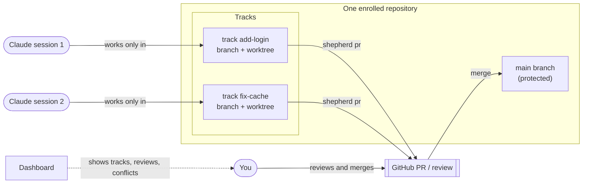
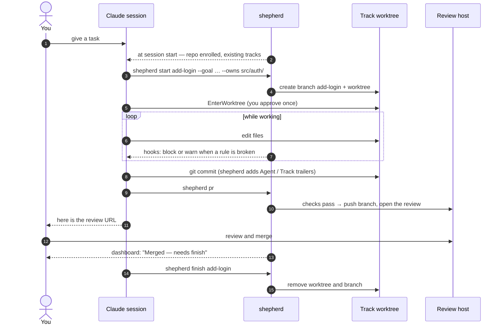
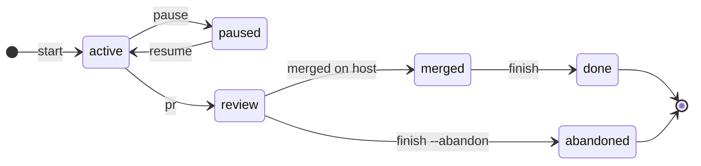
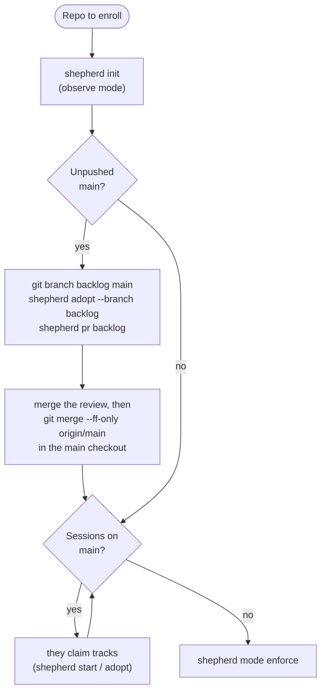

# shepherd

shepherd keeps several Claude Code sessions working on the same repository from stepping on each other, and shows you what each one is doing. Every session works on a **track** — its own branch in its own worktree, with the paths it owns written down — and its work reaches the main branch only through a **review** (a GitHub PR, or your host's equivalent through a private backend). You watch everything on a local dashboard and you merge.



Contents: [Quick start](#quick-start) · [A day with shepherd](#a-day-with-shepherd) · [What agents can and can't do](#what-agents-can-and-cant-do) · [Commands](#commands) · [The dashboard](#the-dashboard) · [Common situations](#common-situations) · [Enrolling a repo](#enrolling-a-repo) · [Limits](#limits) · [Further reading](#further-reading)

## Quick start

1. **Install** (once per machine): run `bash ~/claude-dotfiles/install.sh`. It links the `shepherd` CLI into `~/.local/bin/`, installs the plugin (whose hooks power shepherd) and any private review backends. Then check:

   ```bash
   shepherd doctor
   ```

   Every line should be ✓. Restart running Claude Code sessions (or `/reload-plugins`) so they load the hooks.
2. **Enroll a repository** — in its main checkout:

   ```bash
   shepherd init                # observe mode: agents are warned, nothing is blocked
   shepherd mode enforce        # later, once you're happy: rule-breaking edits are blocked
   ```

   Only you can run `init --mode enforce`, `mode` and `uninit`; shepherd refuses them inside a Claude Code session. Repos you don't enroll behave exactly as before.
3. **Open the dashboard**: type `/shepherd` in any session, or run `shepherd serve --daemon`. It prints a URL like `http://127.0.0.1:7799/?t=<token>` — on a remote machine, forward port 7799 first (VS Code: *Ports → Forward*, or `ssh -L 7799:localhost:7799 <host>`).

## A day with shepherd

You give sessions tasks; they follow the `parallel-sessions` skill, which drives shepherd. This is what one task looks like from start to merge:



Every track moves through these states; the dashboard groups cards by them:



Each label is a `shepherd` command, except *merged on host*, which the dashboard's poller notices within about two minutes. Running `shepherd pr` again in *review* updates the same review. `shepherd adopt` also creates an *active* track; `finish --abandon` works from any state. `shepherd finish` also works straight from *active* or *review* once the branch's changes are on main (fast-forward, merge, rebase or squash merge all count).

## What agents can and can't do

In an enrolled repository, inside a Claude Code session:

| The agent… | observe | enforce |
|---|---|---|
| edits a file on a protected branch (default: the main branch) | warned | **blocked** |
| edits in a worktree owned by another *live* session | warned | **blocked** |
| edits a file another active track owns or has changed, or that another session edited in the last 2 h | warned | warned |
| runs `git add -A` / `.` / `-u`, `commit -a`, `stash`, `reset --hard`, `clean -f`, `checkout -- .`, `restore .` | warned | **blocked** |
| commits on, or pushes to, a protected branch | allowed, with a message | **refused by the git hooks** |
| uses `--no-verify`, `SHEPHERD_ALLOW_MAIN`, a `core.hooksPath` override | warned | **blocked** |
| runs `shepherd init --mode enforce`, `mode`, `uninit` | refused | refused |

Each warning is shown to a session at most once an hour. Your own commands — anything run outside a Claude Code session — are never checked, blocked or rewritten.

## Commands

What agents run (the skill tells them when):

| Command | Does |
|---|---|
| `shepherd status` | tracks in this repo; `--all` for every enrolled repo, `--json` for scripts |
| `shepherd start <track> --goal "…" --owns <path>…` | claim a track: new branch + worktree from the remote main branch; refuses if `--owns` overlaps an active track |
| `shepherd adopt [--path WT \| --branch BR]` | register an existing worktree or branch as a track |
| `shepherd log --to <track> --type request\|handoff\|note "…"` | message another track; `shepherd inbox` lists yours, `shepherd accept <id>` accepts one |
| `shepherd sync` | rebase your track onto the latest main |
| `shepherd pr` | open (or update) the track's review after the checks pass |
| `shepherd pause --note "…"` / `shepherd resume <track>` | park a track / take over one whose session ended |
| `shepherd finish <track>` | after the merge: remove the worktree and branch |

What you run:

| Command | Does |
|---|---|
| `shepherd init [--test "<cmd>"]` | enroll the repo; `--test` makes `shepherd pr` run your tests first (re-run `init` to change settings) |
| `shepherd mode enforce` / `observe` | switch blocking on or off |
| `shepherd uninit` | un-enroll (hooks removed, history kept) |
| `shepherd serve --daemon` / `--stop` | start or stop the dashboard |
| `shepherd doctor` | check the install, every enrolled repo and the review backends |

## The dashboard

- **Fleet** — one lane per enrolled repo, cards in *Active / In review / Merged — needs finish / Paused*. A card shows the session (live, idle or ended), the goal, the session's own title for its work, ahead/behind main, uncommitted files, the last commit and edit, and the review with its checks. The lane header warns about unpushed commits on main and uncommitted files in the main checkout; below the cards come worktrees that aren't tracks and pairs of tracks touching the same files. A last lane lists running sessions that aren't on any track.
- **Track detail** (click a card) — commits, per-file diff against main, uncommitted diff, the review, the coordination log and the edit timeline.
- **Overlaps** — a matrix of the tracks in each repo: how many files each pair both touches, red when merging them would conflict.
- **Activity** — the last two hours of edits, one swimlane per session.

It refreshes every 3 s while the tab is visible and re-checks reviews every 2 minutes. It only listens on 127.0.0.1, needs the token from the printed URL, and changes nothing.

## Common situations

- **Two agents want the same files.** The second `shepherd start` is refused, and a request is logged to the track that owns them. The agent tells you; you decide whether it waits, narrows its `--owns`, or goes ahead with `--force`.
- **A session ended mid-task.** Its card says *owner session ended*. Start a new session inside that track's worktree and it takes the track over automatically — or run `shepherd resume <track>`.
- **Main moved on.** `shepherd pr` refuses while the track is behind; the agent runs `shepherd sync`, re-tests and tries again.
- **The checks refuse `shepherd pr`.** It runs, in order: tree clean → has commits → not behind main → no conflict with main → tests pass (if configured). The message says which one failed and what to run.
- **An agent asks you to lift a block.** Don't, for the agent. Make the change yourself (your commits are never blocked), or switch the repo to `observe`.
- **The review chip shows an error with a hint** (e.g. "run `gh auth login`"). Do what the hint says; the chip recovers on the next check.
- **You can't approve your own PR.** Agents push with your `gh` login, so you're the PR's author. On a repo without branch protection, merging is the review.

## Enrolling a repo



`shepherd init` lists the existing worktrees it can adopt and warns about unpushed commits. `shepherd start` refuses to branch from the remote while local main has commits the remote doesn't (they'd be missing from the track); `--from <main>` builds on them instead. Hosts other than GitHub need a private review backend — see [docs/backends.md](docs/backends.md).

## Limits

- Protection is a guardrail for cooperative agents, not a security boundary: a session that edits files through shell redirection isn't stopped by the edit hook, only by the commit hook when it tries to commit on main.
- Only Claude Code sessions are tracked; other tools and your own work are invisible to it, apart from showing up as uncommitted files or untracked worktrees.
- State lives in `<git-common-dir>/shepherd/` (shared by all worktrees, never committed) and `~/.claude/shepherd/`. `claude-sessions.md` next to the git dir is a generated view; don't edit it.

## Further reading

- [docs/architecture.md](docs/architecture.md) — how it's built: components, hooks, state, the dashboard, design decisions, tests.
- [docs/backends.md](docs/backends.md) — how a review is opened, and how to write a backend for another host.
- [`skills/parallel-sessions`](../../skills/parallel-sessions/SKILL.md) — the instructions agents follow.
