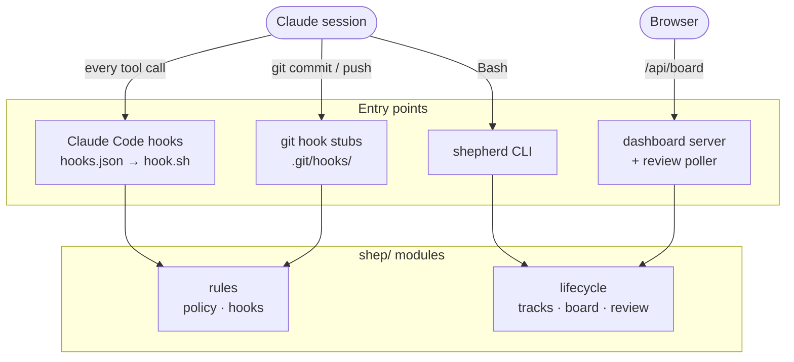
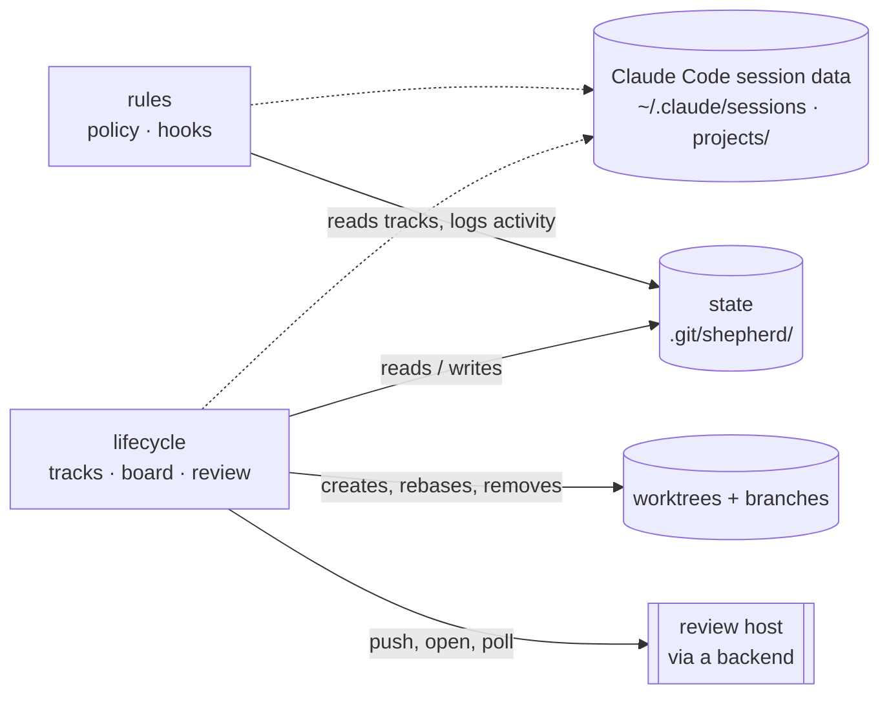
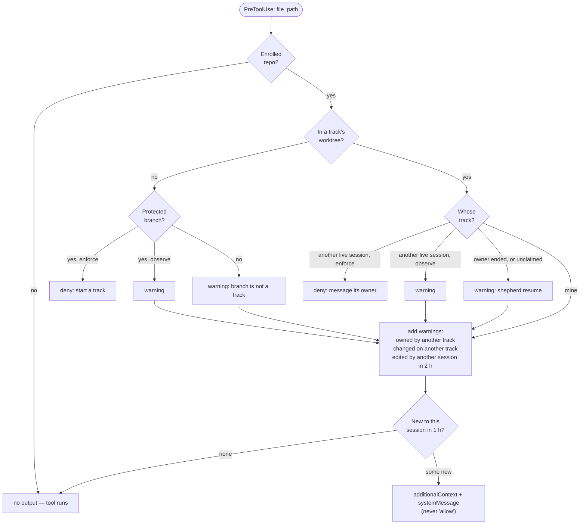
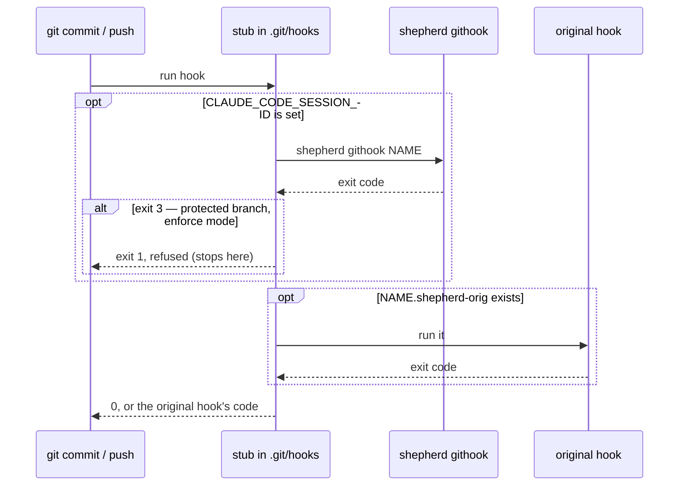
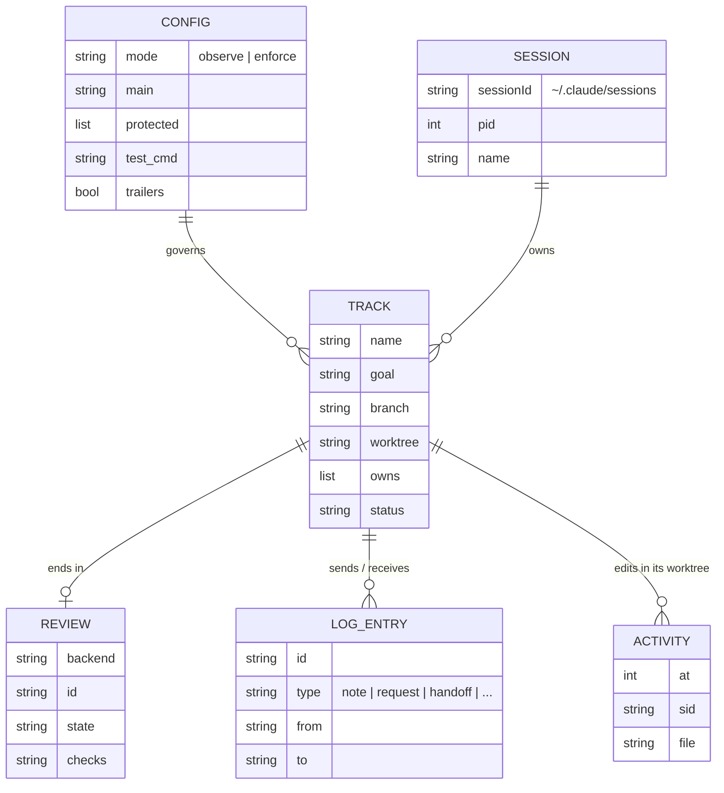
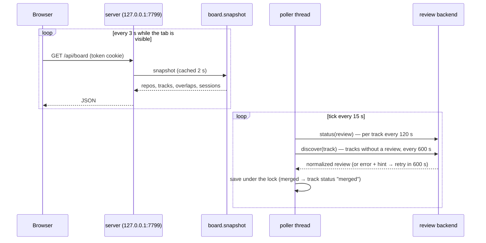

# shepherd — how it's built

For contributors changing shepherd. The user guide is the [README](../README.md); review backends have [their own page](backends.md). Everything here is stdlib Python 3.9+ and git ≥ 2.38 (for `git merge-tree --write-tree`).

## Components

Four entry points lead into two groups of modules: the rules (what may happen) and the lifecycle (what the board shows and the commands do).



Both groups share the state in the repository's git dir and read Claude Code's own session files (dotted: the registry for who is live, transcripts for titles and subagents); only the lifecycle touches branches and the review host:



| Module | Responsibility |
|---|---|
| `shepherd.py` | Entry point. `hook` and `githook` bypass argparse and catch every exception — see [Failing open](#failing-open). |
| `hook.sh` | Plugin hook launcher: runs `~/.local/bin/shepherd` (the live checkout) if present, else the plugin's own copy, so hooks and CLI run the same code. |
| `shep/gitx.py` | Repo resolution in pure Python (no subprocess on the hook hot path); worktrees, ahead/behind, `merge-tree` conflict prediction, the merged check. |
| `shep/store.py` | State files: atomic JSON writes, single-write JSONL appends, `flock` locking, the generated `claude-sessions.md`. |
| `shep/identity.py` | The session behind a process, liveness, the session's auto-title. |
| `shep/policy.py` | Pure rules (no I/O): `decide_edit`, `classify_git` — table-tested. |
| `shep/hooks.py` | Adapters from Claude Code hook JSON and git hook argv to the rules; git hook stub installer. |
| `shep/tracks.py` | The lifecycle commands: `init`, `start`, `adopt`, `resume`, `pause`, `log`, `sync`, `pr`, `finish`. |
| `shep/review.py`, `shep/backends/` | Backend protocol, loader, built-in GitHub backend — [backends.md](backends.md). |
| `shep/board.py` | The snapshot behind `shepherd status` and the dashboard; `agents_graph()` for the Agents tab. |
| `shep/agents.py` | Each session's subagents and every agent's current step, read from the transcripts Claude Code keeps (`~/.claude/projects/<project>/<session>/subagents/agent-<id>.{jsonl,meta.json}`). |
| `shep/graphs.py` | The Graph tab: finds omnigraph stores, parses them the way the mod does (its options from `pluginConfigs` in user settings, its presets from `mods/omnigraph/presets/`), and reads the ops feed from the mod's `$.store` files (`~/.claude/plugins/store/omnigraph_*.json`). Served by the server only. |
| `shep/server.py` | `127.0.0.1` HTTP server (token cookie, read-only JSON API) and the review poller thread. |
| `shep/cli.py` | argparse front end, text rendering, `doctor`. |
| `static/` | Dashboard UI: vanilla JS, no build step, no CDN, DOM built with `textContent` only. |

## Who is acting

Claude Code sets `CLAUDE_CODE_SESSION_ID` and `CLAUDE_PID` on every tool subprocess (and on hooks). `CLAUDE_PID` names the session's registry file, `~/.claude/sessions/<pid>.json`, which carries the session's `name`, `status` (busy, idle, shell) and `procStart`. A session is **live** when `/proc/<pid>` exists and its start time (field 22 of `/proc/<pid>/stat`) still equals `procStart` — so a recycled pid doesn't count. Process ancestry can't be used: the Bash tool's shell isn't a descendant of the claude process. A track stores its owner as `agent = {kind: "claude", session_id, name, pid, proc_start}`; `kind` is the extension point for other agents.

No session id in the environment means a human: that is what exempts your own commands from every rule.

## How an edit is checked

The PreToolUse hook for `Edit|Write|MultiEdit|NotebookEdit` resolves the target file's checkout (a repo is enrolled when `<git-common-dir>/shepherd/config.json` exists), then decides:



A deny is `hookSpecificOutput.permissionDecision = "deny"` with a reason that says exactly what to run instead. Warnings are `additionalContext` only — shepherd never emits `allow`, which would skip your normal permission prompts. "Changed on another track" uses the files in that track's branch since its base, cached per branch sha in `cache/changed.json`; "edited by another session" reads the tail of `activity.jsonl`, which the async PostToolUse hook appends to.

The PreToolUse hook for `Bash` exits immediately unless the command mentions `git` or `SHEPHERD_ALLOW_MAIN`. Otherwise `policy.git_calls` splits the command line (`&&`, `;`, `|`, …), follows `cd` and `git -C` to find the repository each git call targets, and `classify_git` matches the forbidden operations listed in the README. Enforce mode denies; observe mode only adds context.

The SessionStart hook adds up to 16 lines of context in an enrolled repo — mode, whether you're on a protected branch, the tracks and their owners, your inbox — and claims the track for the new session if it starts inside a track whose owner has ended.

## Git hooks

`shepherd init` writes three stubs into `<git-common-dir>/hooks/` — `pre-commit`, `pre-push`, `prepare-commit-msg` — shared by every worktree. An existing hook is renamed `<name>.shepherd-orig` and still runs; `shepherd uninit` restores it. `init` refuses if `core.hooksPath` is set, since git would ignore the stubs.



Exit code 3 is the only "refuse": a Python traceback (1) or a missing interpreter (127) lets git proceed, so a broken shepherd never blocks work. `pre-push` refuses only `refs/heads/<protected>` destinations — whatever refs a backend's tool pushes for a review pass. `prepare-commit-msg` adds `Agent: claude-code`, `Agent-Session: <8 chars>` and `Track: <name>` with `git interpret-trailers --if-exists addIfDifferent` (idempotent across amends), unless the repo's `trailers` setting is off; merge and squash messages are left alone.

## State

Per repository, in `<git-common-dir>/shepherd/` — one directory for all worktrees, never committed:



| File | Holds |
|---|---|
| `config.json` | `mode`, `remote`, `main`, `protected`, `worktree_dir` (default `..`), `test_cmd`, `test_timeout` (900 s), `trailers`, `pr_draft`, `review_backend` |
| `tracks/<name>.json` | one track, with its `agent` and normalized `review`; finished tracks are archived to `tracks/archive/` when the name is reused |
| `log.jsonl` | the coordination log; whether a request was accepted is derived from later `accept` entries |
| `activity.jsonl` | one line per edit by a session; rotated to `activity.1.jsonl` past 2 MB |
| `sessions/<sid>.json` | per-session hook memory (which warnings were shown, when) |
| `cache/` | changed files per branch sha; `merge-tree` verdicts per sha pair |
| `../claude-sessions.md` | generated view for older sessions; a hand-written ledger found at `init` is kept as `claude-sessions.legacy.md`, a hand-edited generated one as `claude-sessions.<ts>.md` |

Per machine, in `~/.claude/shepherd/` (or `$SHEPHERD_HOME`): `repos.json` (written only by `init`/`uninit`), `server.json` (pid, port, token; mode 0600), `server.log`, `hook-errors.log`, `backends/`. Every file carries `schema: 1`; writers keep keys they don't know, and a reader that meets a newer schema leaves the file alone.

## Concurrency

Any number of hooks, CLIs and the poller may run at once. JSON files are written to a temp file and renamed into place. JSONL lines are appended with a single `write` on an `O_APPEND` descriptor. Read-modify-write of a track happens under `flock` on `.lock` — the CLI waits up to 10 s, hooks 1 s and then skip their write rather than stall a tool call. Generating `claude-sessions.md` also takes the lock, so two renders can't be mistaken for a hand edit.

## The dashboard and the poller



The snapshot is local only — git and state files, no network; review states come from what the poller stored. The Agents tab polls `/api/agents` (`board.agents_graph`): every session on the board with its subagent tree from `agents.py`, plus links between tracks — log messages from the last 24 h and the overlaps. A subagent's status comes from its transcript: *done* when its last turn ended without a tool call, *stopped* when the user stopped it, *interrupted* when its session is no longer live, *stalled* after 15 minutes of silence, else *running*. Overlaps are computed from each working track's changed and uncommitted files, and `git merge-tree` runs only for pairs that share committed files (cached by the sha pair). The Graph tab polls `/api/graphs` (`graphs.listing`): each store with its counts and its root's ops, a store parsed again only when one of its files' mtime or size changes; it fetches `/api/graph?id=` (the whole store, each file at most 4 MiB as in the mod) only when the store's version moves. Only ids the discovery hands out are served, so the query never names a path. The server answers only `Host: 127.0.0.1|localhost|[::1]` (against DNS rebinding), requires the token cookie set by the printed `?t=` URL, sends a strict CSP, and has no endpoint that changes anything. `shepherd serve --daemon` reuses a running server only if its version and code location match.

## Failing open

shepherd sits in the path of every tool call and every agent commit, so it must never be the thing that breaks them:

- Claude Code reads hook exit code 2 as "block", and argparse exits 2 on a usage error — so `hook`/`githook` skip argparse, catch everything, log to `~/.claude/shepherd/hook-errors.log` and exit 0. `hook.sh` always exits 0 too.
- Outside an enrolled repo the edit hook costs about 40 ms (Python start + reading `.git/HEAD`) and the Bash hook about 20 ms, and neither writes anything.
- Git stubs block only on exit code 3, as above.
- A backend that fails to import is reported by `shepherd doctor` and otherwise ignored.

## Design decisions

- **Only Claude Code sessions are checked.** Your own commits and tools are never blocked or rewritten; the environment variable is the boundary.
- **Opt-in per repository, observe before enforce.** Some repos commit to main by design (a notes vault, autonomous builds); they stay untouched unless enrolled.
- **State in the git common dir.** Shared by every worktree for free, invisible to `git status`, gone with the clone.
- **Generic core, private backends.** The core names no host but GitHub; anything else is a file in `~/.claude/shepherd/backends/`.
- **Agents can't lower protection.** `init --mode enforce`, `mode` and `uninit` refuse inside a session, and the Bash hook blocks the usual bypasses. It's a guardrail for cooperative agents, not a sandbox.

## Tests

```bash
python3 -m unittest discover -s harnesses/shepherd/tests -t harnesses/shepherd/tests
```

`tests/support.py` builds a sandbox per test: a private `HOME` and `SHEPHERD_HOME`, a bare remote whose main branch is `trunk` (so nothing may assume a branch name), fake live sessions (a sleeping process plus a registry entry with its real start time) and a fake `gh` on `PATH` that logs its arguments. `test_policy.py` holds the command table; `test_hooks.py` drives the real entry point with hook JSON and real git commits; `test_flow.py` runs start → pr → squash-merge on the remote → finish.
