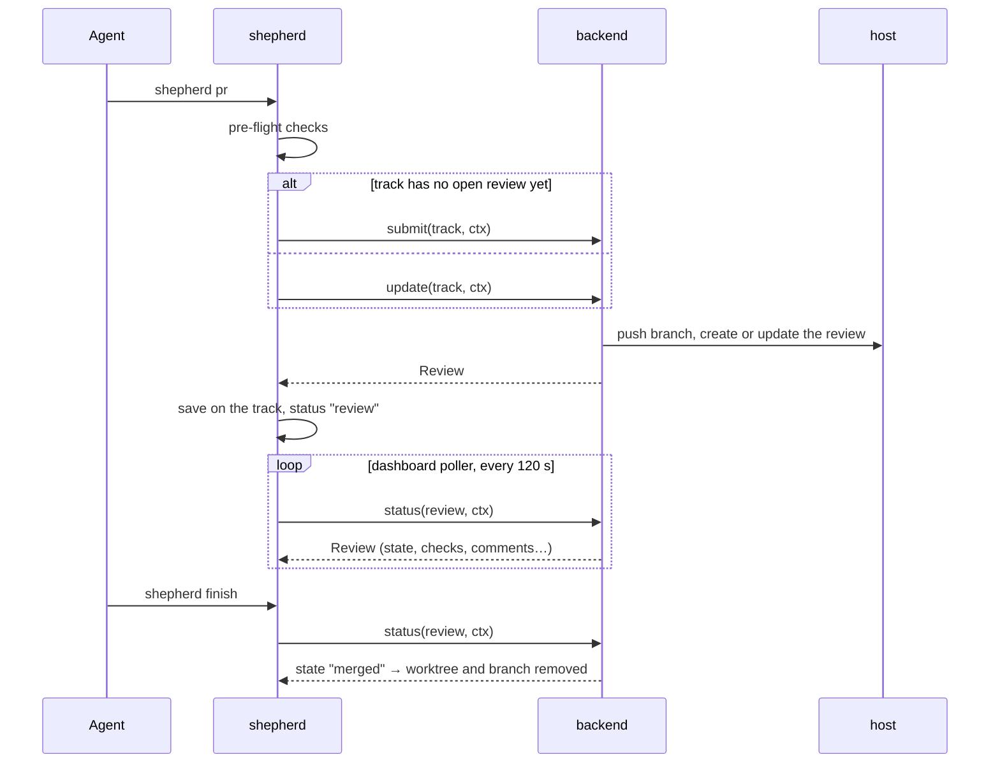
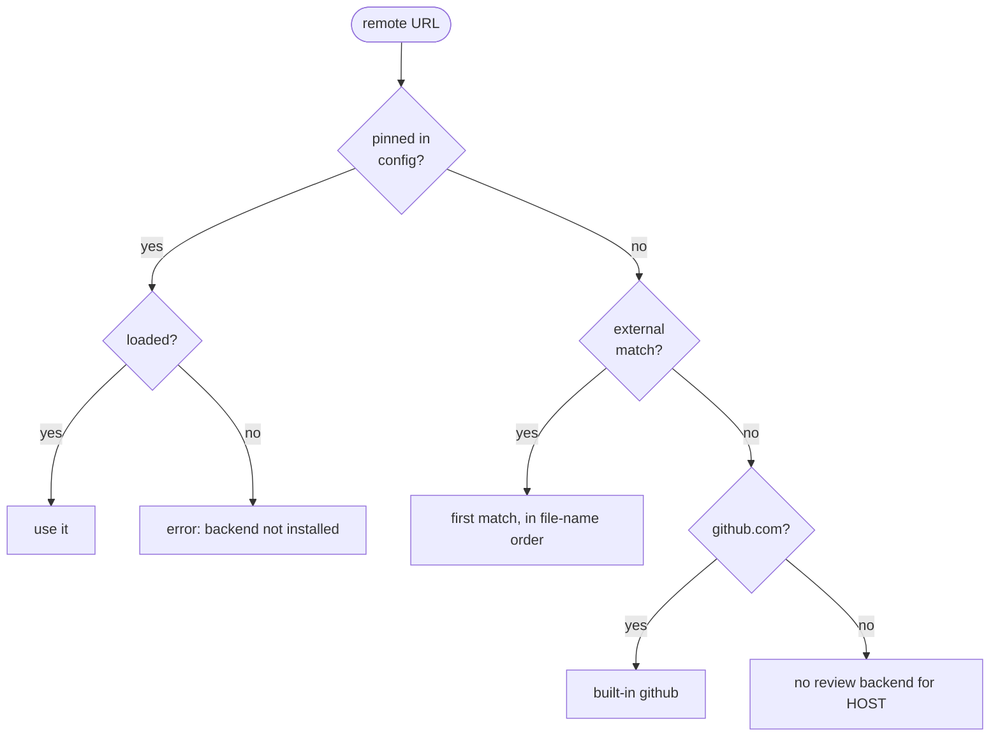

# Review backends

A review backend turns a track into a review on the repository's host — a GitHub pull request, or its equivalent elsewhere — and reports that review's state back to shepherd. GitHub is built in; any other host is a single Python file you drop into `~/.claude/shepherd/backends/`. This page is for whoever writes one. How shepherd is built overall: [architecture.md](architecture.md).

## Where backends are called

Three moments touch a backend: an agent opens or updates a review, the dashboard's poller checks on it, and `finish` asks whether it merged.



## What `shepherd pr` checks before calling you

A backend is only called once the track is safe to review. The checks run in this order and the first failure stops `shepherd pr`:

| # | Check | On failure |
|---|---|---|
| 1 | the track isn't owned by another live session | refuse; message the owner instead |
| 2 | its worktree exists, is on the track's branch, and has nothing uncommitted | refuse; commit by name first |
| 3 | the repo has a remote, and a backend matches its URL | refuse: "no review backend for HOST" |
| 4 | the branch has commits beyond main (after a fetch) | refuse: nothing to review |
| 5 | the branch isn't behind main | refuse: run `shepherd sync` |
| 6 | `git merge-tree` finds no conflict with main | refuse: sync and resolve |
| 7 | `test_cmd`, if configured, passes | refuse with the test output |

Then conflicts with other tracks are printed as warnings, and `submit` is called — or `update`, when the track already has a review from the same backend that isn't merged or closed.

## Which backend is chosen

shepherd matches on the remote URL as configured (`remote.<name>.url`, before any `insteadOf` rewriting), and `config.review_backend` can pin a backend by name:



External backends are loaded from every directory in `$SHEPHERD_BACKENDS` (`:`-separated) and then `~/.claude/shepherd/backends/`, in file-name order, before the built-in one — so a private backend can take over a host. Hooks never load backends; only the CLI and the dashboard do.

## The interface

A backend is a module that defines `SHEPHERD_API = 1` and a `BACKEND` object:

```python
SHEPHERD_API = 1

class MyHost:
    name = "myhost"                                  # shown in doctor, stored on reviews

    def matches(self, remote_url: str) -> bool:      # do you own this remote?
        return "git.example.com" in remote_url

    def submit(self, track: dict, ctx) -> dict:      # create the review → Review
        ...

    def update(self, track: dict, ctx) -> dict:      # publish new commits → Review
        ...

    def status(self, review: dict, ctx) -> dict:     # current state → Review; never raise
        ...

    def doctor(self) -> list:                        # [(ok, label, hint), ...]
        return [(True, "myhost CLI", "")]

    # optional
    def discover(self, track: dict, ctx):            # a review opened outside shepherd → Review | None
        ...

    def config_defaults(self, remote_url: str) -> dict:   # merged into config at `shepherd init`
        return {"trailers": False}


BACKEND = MyHost()
```

`track` is the track's JSON (`name`, `goal`, `branch`, `worktree`, `base`, `owns`, `review`, …). `ctx` is a `shep.review.Ctx`:

| Field | Meaning |
|---|---|
| `worktree`, `repo_root` | the track's worktree; the main checkout |
| `remote`, `remote_url`, `main` | remote name, its configured URL, the main branch |
| `branch`, `base_sha`, `head_sha` | the track's branch, the main commit it's compared against, its tip |
| `title`, `title_explicit` | a title (the commit subject for one commit, else the goal); whether the user passed `--title` |
| `body` | a generated description (goal, commits, files, heads-up, coordination log) or the user's `--body-file` |
| `draft`, `reviewers`, `extra_args` | `--draft`, `--reviewers`, and anything after `--` on the `shepherd pr` command line |
| `run(cmd, cwd=None, timeout=120, input=None)` | run a command in the worktree → `(rc, stdout, stderr)`; never raises, no prompts |
| `log(msg)` | print progress for the user |

A **Review** is a plain dict; shepherd normalizes whatever you return:

| Key | Values |
|---|---|
| `id`, `url`, `title` | the host's identifiers; ids that are all digits are shown as `#123`, others as-is |
| `state` | `draft` · `open` · `approved` · `changes_requested` · `merged` · `closed` · `unknown` |
| `raw_state` | the host's own wording, for the tooltip |
| `checks` | `passing` · `failing` · `pending` · `none` · `unknown` |
| `comments`, `reviewers`, `updated_at` | counts and names for the card |
| `pushed_sha` | the commit you published (lets an update after a rebase use `--force-with-lease`) |
| `error`, `hint`, `stale` | what went wrong, what the user should run (shown verbatim on the card), and whether the rest is old data |

## Rules

- **`status` never raises.** Return the last review with `error`, `hint` and `stale: True` instead; the poller backs off 10 minutes and the card shows your hint (e.g. "re-authenticate: run …").
- **Never prompt.** There's no terminal behind a hook or the poller; pass non-interactive flags and close stdin (`ctx.run` already does).
- **Push only the track's branch** (or whatever review refs your host's tool pushes). In enforce mode the `pre-push` hook refuses agent pushes to protected branches.
- **Don't rewrite the track's commits** (no amending to add review links): the branch must stay what the agent committed. Record the review id in the returned Review instead.
- **Respect the team's conventions.** If the host applies its own description template, don't override it unless `ctx.title_explicit` or the user asked; set `config_defaults` to `{"trailers": False}` when teammates read the commit messages.

## The built-in GitHub backend

`shep/backends/github.py`, using the `gh` CLI, always with `--repo owner/name` parsed from the remote URL:

| Call | Does |
|---|---|
| `submit` | `git push -u <remote> <branch>`, then reuses an open PR for the branch (`gh pr list --head`) or creates one (`gh pr create --base <main> --head <branch> --title … --body-file -`) |
| `update` | `git push`; after a `shepherd sync` rebase, `--force-with-lease=<branch>:<pushed_sha>` |
| `status` | `gh pr view --json state,isDraft,reviewDecision,statusCheckRollup,…` → merged / closed / draft / approved / changes_requested / open; checks from the rollup |
| `discover` | `gh pr list --head <branch> --state all` |
| `doctor` | `gh` present, `gh auth status` |

## Installing and testing one

Put the file (or a symlink to it) in `~/.claude/shepherd/backends/`, then `shepherd doctor` should list it under *review backends* with its own checks — or a load error. To try it without installing, point `SHEPHERD_BACKENDS` at its directory. In tests, give `ctx.run` fake tools on `PATH` (see `tests/support.py` for the fake `gh`), and check `submit`, `update` and the `status` mapping for every state your host has. A private backend kept in claude-dotfiles lives in the repo's gitignored private-skills folder (see the repo README), next to an `install.sh` that creates the symlink; the repo's own `install.sh` runs it.
