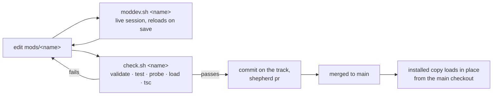

# mods

Claude Code mods: panes, bands above the prompt, status lines and commands that run inside Claude Code, written as a plugin of function hooks. Every folder here is one mod and its own plugin, with its own manifest, tests and marketplace entry, so each one installs, updates and turns off on its own.

| Path | What it is |
| :- | :- |
| `_template/` | The starter mod (`mod-template`): an observe-only `/mod-template` pane and a one-line band. Copy it; it is never installed. |
| `fleet/` | An observe-only band and `/fleet` pane: shepherd tracks, sessions waiting on you, and whether headless `claude -p` runs really finished. [`fleet/README.md`](fleet/README.md) |
| `omnigraph/` | A live typed-graph pane: a node-link drawing, a Miller browser and an op feed that follow the graph commands Claude runs. A demo CLI and store in `demo/`, ready-made settings in `presets/`. [`omnigraph/README.md`](omnigraph/README.md) |
| `check.sh` | The gate: validate `--strict` plus rules of its own, tests, a probe (inert where nothing draws, events passed on unchanged), a headless load, `tsc`. Exits 1 on a finding, 2 when a step could not run. |
| `CLAUDE.md` | The rules for writing a mod here: API spelling, observe-only, surfaces, side effects, limits, off switches. |
| `.debug/` | Debug logs and check output. Gitignored. |
| `../harnesses/tools/moddev.sh` | Opens a live session with one mod loaded from this checkout. |

Needs Claude Code 2.1.287 or later (mods are on by default from there; this folder was verified on 2.1.294 and 2.1.295), `python3`, and `npx` for the pinned TypeScript 6.0.3 that `check.sh` runs. It uses the copy already in the npx cache and asks npx only when there is none (one try, 15 s per request), so an expired registry login or no network only matters before the first download; set `MODS_TSC` to a `tsc` of your own (a path, or a command line) to skip npx.

## Start a mod

```bash
cp -r mods/_template mods/my-pane && rm -rf mods/my-pane/.claude-plugin/types
grep -rlZ mod-template mods/my-pane | xargs -0 sed -i -- 's/mod-template/my-pane/g'
mods/check.sh my-pane
harnesses/tools/moddev.sh my-pane
```

The folder name is the plugin name. The NUL-separated `grep -Z | xargs -0` and the `--` keep a file name from reading as an option, without which a worktree-isolated session (a shepherd track) refuses the command; on macOS write `sed -i ''` for `sed -i`. `check.sh` lays the types again. [`_template/README.md`](_template/README.md) lists every place the name appears and what to delete.

## Dev loop



- `harnesses/tools/moddev.sh <name> [claude args...]` runs `claude --plugin-dir mods/<name> --debug-file mods/.debug/<name>.log`. The session reloads the module on save (Claude's own edits when its turn ends) and the `--plugin-dir` copy stands in for an installed plugin of the same name. The folder is a protected path: each edit Claude makes there prompts you in default and `acceptEdits` mode and goes to the classifier in auto mode (denied in `dontAsk`, allowed in `bypassPermissions`). Follow the log with `tail -f mods/.debug/<name>.log | grep <plugin-name>`; a loaded mod has a line `hooks module <plugin-name>@inline loaded (...); events: ...`.
- `harnesses/tools/moddev.sh <name> --smoke` (same as `mods/check.sh --load <name>`) loads the mod in a headless session that reads no user settings, MCP config or caller environment (`CLAUDE_CODE_PLUGIN_DIRS`, bare mode), sends every request to a closed local port and runs no model turn, and prints that line.
- `mods/check.sh <name>` before every commit, `mods/check.sh --all` for every mod (it also fails two mods with one plugin name). Validate fails a gating hook without `.catch`, any hook on `tool.check`, `classic.PreToolUse` or `classic.PermissionRequest` (globs included), a hook on an event the probe does not fire that the README does not declare, and anything in the plugin but its hooks module. The probe, a generated test, fires every event the mod hooks of the ones it knows (tool calls from the main loop and a subagent, run, refused, failed and refused beneath; prompts and what Claude reads; commands, the mod's own too wherever it has not registered it; `/config`, compaction, subagents, turns, classic events), with the values its matchers name, in a terminal, on the desktop, before `session.start` and with nothing attached, and again with each boolean option flipped. It fails when one comes back changed, and when, with nothing attached, any hook makes a `$` call but the reads. The headless load that follows (skipped when the probe saw the mod act) proves the module loads, that the engine logged no `$` call but the reads from it and no settings-style hook, and lays the types `tsc` needs (`<mod>/.claude-plugin/types/` exists only after a load). [`CLAUDE.md`](CLAUDE.md#what-checksh-holds-you-to) has the full list. Two checks of the same mod run one after the other.
- `mods/check.sh --staged` is for a pre-commit hook ([below](#check-mods-at-commit)). It checks each staged mod as the index holds it (not the working tree), in the main checkout and in a linked worktree alike, prints nothing and exits 0 when the commit touches no mod, and only warns when `claude`, `python3` or `tsc` is missing or could not run. A test, probe or load that outlives `MODS_TIMEOUT` (120 s) is a finding.
- `mods/check.sh --selftest` builds forty-nine copies of the template and fails unless each ends as expected: six good ones (a `tool.call` and a `classic.PostToolUse` observer, a tool of the mod's own, a manifest with a BOM, an observer that sleeps, a change declared in a bold list item) pass; the others fail at validate (no `.catch`; `tool.check`, `classic.PreToolUse`, `classic.PermissionRequest` and `classic.*` hooks; a README line declaring `tool.check`; an unprobed `session.append` hook; a settings-style hook; an `.mcp.json`; a plugin named unlike its folder; a misspelled event), the probe (refusing every call, `Write`, a subagent's calls, `git push` by a RegExp, by a string with a space or a comma, or by an alternation, or a whole MCP server; a RegExp it cannot sample; rewriting `Bash`; turning a refusal into a result; running a failed call again; a refusal whose text names the kit's own failure; refusing only on the desktop or with the option off; answering a connected server's tool by its plugin name; answering its own command without `next` where it never registered it; blocking `Stop`; refusing subagents; dropping system-prompt sections, also with the README line hidden in a comment; a timer, a model call, a tool call, a process, a turn abort, a fetch from a `tool.call` observer or a process from a `classic.SessionStart` observer with nothing attached), the tests (a failing test, no tests, a test that never ends) or `tsc`. Run it after a Claude Code update, with `--all`; it takes about three minutes.

## Check mods at commit

Optional, and by hand: `install.sh` sets up no git hook. A pre-commit hook that runs `mods/check.sh --staged` checks each mod a commit touches, a few seconds a mod (3 s for the template, 10 s for omnigraph), and costs nothing in a commit that touches none. The guards' secret scanner (`hooks/guards/precommit_scan.py`) takes the same slot, and its `install` chains whatever it finds there, so write the mods stub first, then install the scanner:

1. Write this stub and make it executable. It goes in `$(git rev-parse --git-common-dir)/hooks/pre-commit`, or in `pre-commit.shepherd-orig` beside it when `pre-commit` is shepherd's wrapper (it has the line `# shepherd-hook v1`). Never write over a file that is already there. A branch without `mods/check.sh` commits as before.

   ```sh
   #!/bin/sh
   f="$(git rev-parse --show-toplevel)/mods/check.sh"
   [ -x "$f" ] || exit 0
   exec "$f" --staged
   ```

2. `python3 hooks/guards/precommit_scan.py install <repo>` moves the stub to `pre-commit.guards-orig` and runs it after the scan. `precommit_scan.py status <repo>` then says `chains to .../pre-commit.guards-orig`.

If the scanner is already installed, write the stub as `pre-commit.guards-orig` instead, when that name is free: the scanner runs it after the scan. `git commit --no-verify` skips both for one commit.

## Packaging

Each mod is listed as its own plugin in this repo's `.claude-plugin/marketplace.json` (marketplace `claude-dotfiles`), with the same `name` and `version` as its `plugin.json`:

```json
{
  "name": "my-pane",
  "description": "One line on what the pane shows",
  "source": "./mods/my-pane",
  "strict": true,
  "version": "0.1.0",
  "category": "developer-tools"
}
```

Then install it once: `claude plugin install my-pane@claude-dotfiles` (or `/plugin install my-pane@claude-dotfiles` in a session). Because the marketplace is a local directory, the plugin loads in place from the main checkout: a merged change takes effect at the next session start or `/reload-plugins`, with no version bump. Bump `version` in both files when the change matters to someone who installed it from a clone. `/plugin` shows `N mods active · ... my-pane` once it loads, and its `userConfig` values live under `pluginConfigs["my-pane@claude-dotfiles"].options` in user settings (or `claude plugin configure my-pane@claude-dotfiles`).

## Turn a mod off

| To stop | Do |
| :- | :- |
| One installed mod | `/plugin` → Installed → disable, or `claude plugin disable <mod>@claude-dotfiles`, or `"enabledPlugins": { "<mod>@claude-dotfiles": false }` |
| A dev copy | Start without `moddev.sh` / `--plugin-dir`, or `"enabledPlugins": { "<mod>@inline": false }` |
| One feature of a mod | Its `userConfig` option, such as the template's `band` |
| Everything, one session | `claude --safe-mode` (also stops CLAUDE.md, skills, hooks and MCP servers) |

Avoid `"disableAllHooks": true`: it stops every installed mod and every settings hook too, the guard hooks and shepherd included, and the custom status line. [`CLAUDE.md`](CLAUDE.md#off-switches) has the details.
