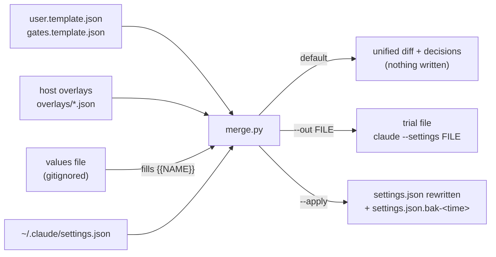

# settings

Versioned Claude Code settings: a user template, a set of write-approval gates, host overlays, and a merge tool that adds them to `~/.claude/settings.json` without losing what is already there. Nothing here is applied by `install.sh` or `install.ps1`: they print the preview command at the end, next to the guards' `precommit_scan.py install|status` and `apply.sh` dry-run commands, and run none of them. You trial the merged file first, then apply it yourself.

| File | What |
|---|---|
| `user.template.json` | Generic user settings: status lines, effort, compaction, prompt-cache lifetime, auto-update freeze. |
| `gates.template.json` | Generic ask and deny rules: pushes ask; the common force-push spellings, history rewrites and reads of `~/.ssh`, AWS credential caches and `.env` are denied. |
| [`overlays/`](overlays/README.md) | What one host adds on top: `amazon.json` (Bedrock, model pins, footer links, marketplaces) and `amazon-gates.json` (write-tool ask rules, the vault push hook, `autoMode`), plus `private.example.json`, the names of the values kept out of git. |
| [`hooks/`](hooks/README.md) | `allow_repo_push.py`, a PermissionRequest hook that approves plain pushes of one repo to one URL. |
| `merge.py` | Deep-merges templates and overlays into a settings file. Dry run by default; `--out` writes a trial file; `--apply` writes atomically after a timestamped backup. |
| `tests/` | `python3 -m unittest discover -s settings/tests`. The `install.ps1` tests run when `pwsh` is on `PATH` or `PWSH` names it, and are skipped otherwise; the private-value check runs when the values file is on the machine. |
| `tools/` | The push hook's fuzz, mutation and latency checks; see [`hooks/`](hooks/README.md#tests-and-tools). |

The status line scripts live in [`../statusline/`](../statusline/README.md).



## What is committed

Everything here is committed, Amazon-flavoured host settings included: tool and MCP server names, model ids, personal paths, the gate logic. What isn't is confidential data: account ids, specific internal hosts and URLs, schema and table names, emails, ticket and review ids. An overlay names such a value with a `{{NAME}}` placeholder, and `merge.py --values FILE` fills it in from a gitignored JSON file (`skills-amazon/settings/private.json` here; [`overlays/private.example.json`](overlays/private.example.json) lists the names). `tests/test_boundary.py` fails when a committed file of `settings/` or `statusline/` has the shape of such a value (an account id, an internal host, a code-host URL path, an email, a ticket or CR id) or, when the values file is present, any of its values.

## What the templates set

Every key below is in the [settings reference](https://code.claude.com/docs/en/settings-reference) (checked for Claude Code 2.1.294 and again for 2.1.295). The schemastore schema in `$schema` lags behind it: it doesn't list `modelSettings`, `autoCompactWindow`, `promptCacheTtl` or `bashEditDiffEnabled` yet, but accepts them because it allows extra keys.

| Key | Value | Why |
|---|---|---|
| `statusLine` | `statusline.sh --compact-window 400000`, `refreshInterval: 1` | Model, effort, context, cache, cost, branch, shepherd track and a clock with seconds. The 1 s refresh keeps the clock ticking while the session is idle. Each render costs about 15 ms of CPU, so that's about 1.5% of one core per open session, all the time. To cut it tenfold, set `refreshInterval: 10` and add `--clock %H:%M`: the shepherd track refreshes every 30 s anyway. |
| `subagentStatusLine` | `subagent-statusline.sh` | One row per running subagent: token sparkline, context use, model, effort. |
| `modelSettings.claude-opus-5-5.effortLevel`, `modelSettings.claude-sonnet-5-5.effortLevel` | `xhigh` | In user settings, Opus 5.5, Sonnet 5.5, Haiku 5.5 and later models ignore a top-level `effortLevel`: each starts at its own default (medium) unless `modelSettings` names it. `/effort xhigh` writes the same entry for the model in use. The entries also apply to `claude -p` runs on that model. Haiku 5.5 is left at medium on purpose, since it runs quick helper work such as Explore subagents; add `claude-haiku-5-5` if you want it at xhigh too. |
| `effortLevel` | `xhigh` | Applies to Opus 5, Fable 5.1 and earlier models in user settings, and to every model when the file is passed with `--settings`, so a trial runs Haiku 5.5 at xhigh even though an applied file won't. |
| `autoCompactWindow` | `400000` | Compact at 400K tokens instead of near the 1M limit. Keep it equal to `--compact-window` in the status line command. `CLAUDE_CODE_AUTO_COMPACT_WINDOW` outranks both, in Claude Code and in the status line. |
| `promptCacheTtl` | `"1h"` | Keeps the main conversation's cache warm across breaks. It applies to `claude -p` and SDK turns too, so cron jobs and harnesses that run `claude -p` also pay the 1-hour write rate (2x base input, versus 1.25x for 5 minutes). Give them `CLAUDE_CODE_PROMPT_CACHE_TTL=5m` in their environment, which outranks the setting. |
| `bashEditDiffEnabled` | `true` | Shows the diff of files a Bash command changed, in every mode (user or managed scope only). |
| `env.DISABLE_AUTOUPDATER` | `"1"` | Freezes the version. This is the documented switch (`claude doctor` shows `disabled (set by env: DISABLE_AUTOUPDATER)`). Observed on a native install: the legacy `autoUpdates: false` flag in `~/.claude.json` didn't stop the background updater. `claude update` still works when you choose to move. This also stops plugin auto-updates unless `FORCE_AUTOUPDATE_PLUGINS=1`. |
| `permissions.ask` / `permissions.deny` | see [Gates](#gates) | Human approval for pushes; hard stops for common force pushes and credential reads. |

Left out on purpose:

- **`timeZone`** and the status line clock zone are personal. Set `timeZone` (UI times) and `env.STATUSLINE_TZ` (the status line clock) in a host overlay, as `overlays/amazon.json` does. Don't set `TZ` in `env`: every Bash command and script Claude runs would inherit it.
- **`disableDeepLinkRegistration: "disable"`** only belongs on headless hosts; see the [cleanup checklist](#one-off-cleanups).
- **Model pins** (`ANTHROPIC_DEFAULT_{OPUS,SONNET,HAIKU,FABLE}_MODEL`) are provider IDs; they go in a host overlay. On a third-party cloud provider, the `sonnet` and `haiku` aliases otherwise resolve to that provider's built-in default, which can lag the newest model ([pin models](https://code.claude.com/docs/en/model-config#pin-models-for-third-party-deployments)).

## Merge rules

- Objects merge key by key. Arrays are unioned: existing items keep their order and new ones are appended, compared by value.
- When the target already has a different scalar, **the target wins** and the decision is printed. `--override` lets the overlay's scalars win everywhere; arrays are still unioned.
- A `PATH` is dotted (`env.FOO`, `hooks.PermissionRequest`) or a JSON pointer (`/extraKnownMarketplaces/my.market`). Marketplace and plugin names may contain dots, and a dot in a dotted `PATH` always separates keys, so name such a key with the pointer form or escape the dot: `'extraKnownMarketplaces.my\.market'` (quote it, or the shell eats the backslash). The decisions print each path in a form you can paste back.
- `--override-key PATH` lets the overlay win at that path and below, and there an array is **replaced** rather than unioned. Use it when an overlay brings a new version of a hook or rule: a plain merge would keep the old entry next to the new one. For example, `--override-key hooks.PermissionRequest` swaps the old vault push hook for the new one. Everything in that array that the overlays don't have is dropped, and the dry run lists each dropped item, so keep the path narrow. `--override-key permissions`, for instance, would replace your whole deny list.
- `statusLine`, `subagentStatusLine`, `fallbackModel`, `modelPicker` and each `extraKnownMarketplaces` entry are one unit: kept whole or replaced whole, never mixed.
- `--remove-key PATH` deletes a key from the result (overlays can only add). On a list or object it deletes **all of it**: `--remove-key permissions.deny` drops every deny rule, yours included, and the dry run says `the whole list, N item(s)`. With no overlay at all, `merge.py` only removes keys.
- Between overlays, a later file wins.
- `{{DOTFILES}}` in an overlay becomes this checkout's root, with forward slashes. Point it at the **main checkout** (`--dotfiles`, or run `merge.py` from there) once the files are on its branch: a track worktree is deleted when the track finishes, and `merge.py` warns when it sees one. A root with `"`, `$`, a backtick or `\` in it is refused, because the status line command quotes the path.
- Each path a `{{DOTFILES}}` string names (the token and the rest of its word, such as `{{DOTFILES}}/statusline/statusline.sh`) must exist. If one the result keeps doesn't, the dry run and `--out` print a warning, and `--apply` refuses unless you add `--force`. Otherwise the status line would go blank, or a hook would be silently missing.
- Any other `{{NAME}}` (A-Z and `_`) comes from `--values FILE`, a JSON object of names to strings; keys starting with `$` are comments. Repeat the flag for several files; a later one wins. A value is inserted as plain text and never expanded again, and nothing quotes it, so use it in exec-form hook `args`, URLs and prose rather than inside a shell command. `merge.py` warns when a values file sits in the checkout without being gitignored.
- The merge refuses to write in these cases:
  - Any input is unreadable (a directory, not UTF-8) or isn't valid JSON. That includes `NaN` and `Infinity`, which Python would otherwise read, numbers out of range such as `1e400`, and nesting too deep to merge.
  - An overlay has a `{{NAME}}` that no `--values` file defines, or a values file has a value that is empty, not a string, or still the example's `<...>` placeholder.
  - The target is read-only, or is a symlink to a missing file. Writing would replace the file despite its mode, or create the link's destination and its folders.
  - A value the target already has would change without one of the flags above.
  - With `--apply`, a `{{DOTFILES}}` path the result keeps doesn't exist (unless `--force`).
- A UTF-8 BOM is accepted on input and dropped on output. A console that can't show a character in the diff (a C locale, a Windows code page) gets it escaped, `\xe9`; the files are always written as UTF-8. A merge that changes nothing leaves the file byte for byte. A write that fails (read-only folder, full disk) prints `merge.py: … cannot write` and leaves no backup or temp file behind.
- `--out` never writes over the target, an overlay or a values file. It replaces an existing file only with `--force`, which keeps a timestamped backup of it.

## Trial, apply, roll back

Run these from the main checkout (`~/claude-dotfiles`) after this branch has merged. Add your host overlays after the two templates, and `--values` when they use placeholders; [`overlays/`](overlays/README.md#merge-order) has the full command for this host.

**1. Preview.** This only prints the diff and one line per decision:

```bash
cd ~/claude-dotfiles
python3 settings/merge.py settings/user.template.json settings/gates.template.json \
  --override-key statusLine
```

`--override-key statusLine` replaces a status line you already have. Leave it out to keep yours.

**2. Trial for one session.** Write the merged result to a separate file and start Claude Code with it. `~/.claude/settings.json` isn't touched. Add `--force` when you rewrite an earlier trial file:

```bash
python3 settings/merge.py settings/user.template.json settings/gates.template.json \
  --override-key statusLine --out ~/claude-settings-trial.json
claude --settings ~/claude-settings-trial.json
```

`--settings` sits above user settings, so the trial's values win, and list keys such as `permissions.deny` are concatenated with your user file. Ask beats allow and deny beats both, whichever file a rule is in, so the trial shows how the gates behave next to your current allow rules. The template's path rules use `~/` and `//` because a `/path` rule anchors at the file it is in: `~/.claude/` for user settings, the trial file's folder for `--settings`.

**3. Apply.** Same command with `--apply`. It refuses if the file changed while the merge ran, for example because Claude Code saved a `/effort` choice. That check is best effort: it runs again just before the rename, but Claude Code takes no lock, so a write that lands in that last instant is lost. Don't change settings in an open session while it runs:

```bash
python3 settings/merge.py settings/user.template.json settings/gates.template.json \
  --override-key statusLine --apply
```

It prints the backup path and the rollback command. Settings reload on save, but restart open sessions to pick up `env` changes.

**4. Verify.**

- `claude doctor`: the Auto-updates line reads `disabled (set by env: DISABLE_AUTOUPDATER)`.
- `/effort` in a session on Opus 5.5 or Sonnet 5.5 shows `xhigh`; on Haiku 5.5, `medium`.
- `claude -p hi --output-format json`: `usage.cache_creation.ephemeral_1h_input_tokens` is above 0.
- The status line shows `ctx N%/400k` and the track name when you're in a shepherd worktree.

**Roll back.** Copy the backup over the file: `cp ~/.claude/settings.json.bak-<time> ~/.claude/settings.json`. To undo a single key, remove it by hand or with `python3 settings/merge.py --remove-key PATH --apply`, for example `--remove-key promptCacheTtl`. That form takes no overlay and keeps a backup too.

There is no item-level undo. `--remove-key` on a list removes the whole list, so `--remove-key permissions.deny` would also drop the deny rules you had before the apply. To undo the gates, restore the backup, or delete the template's rules from the list by hand.

## Gates

A Bash rule matches the command text after Claude Code splits compound commands and strips wrappers such as `timeout` and `nohup`. Deny and ask rules also match past any leading `VAR=value` assignment. Inside a rule, `*` matches any text, spaces included. Deny wins over ask, and ask over allow, in every mode.

| Rule | Effect |
|---|---|
| `Bash(git push *)` (ask) | Every `git push …` asks, even with an allow rule such as `Bash(git *)` in place, and even in auto and bypass modes. |
| `Bash(git -* push)`, `Bash(git -* push *)` (ask) | A push after git global options (`git -C dir push`, `-c k=v`, `--no-pager`, `-P`, `--git-dir=…`) asks too. **False positive:** any git command that starts with a global option and has the word `push` in it asks as well, e.g. `git -C dir commit -m "explain why every push asks"`, `git -C dir log --grep push` or `git -C dir stash push`. Run those from the repo without `-C`, or reword the message. |
| `Bash(git push --force* / -f* / +refspec / --m*)`, also with arguments before the flag, and the same flag or refspec as a whole quoted word (`'-f'`, `"--force"`, `'+main'`) (deny) | The common force-push spellings are refused in every mode. `--force-with-lease` counts as a force push. `--m*` covers `--mirror` and every abbreviation git takes for it, down to `--m`; git rejects `--forc` and shorter as ambiguous. These rules are anchored at `git push`, so a commit message that mentions them never hits a deny. |
| `Bash(git filter-branch *)`, `Bash(git filter-repo *)` (deny) | History rewrites are refused. |
| `Read(~/.ssh/**)` (deny) | Everything under `~/.ssh`: private keys, and also `config`, `known_hosts`, `authorized_keys` and `*.pub`. A Read deny blocks Edit and Write on the same paths, so adding a `Host` entry is your job too. |
| `Read(~/.aws/credentials)`, `Read(~/.aws/{cli,sso}/cache/**)`, `Read(~/.aws/login/**)` (deny) | Cached AWS credentials. `~/.aws/config` stays readable and editable. |
| `Read(//**/.env)` (deny) | Any file **or directory** named `.env`, anywhere on the disk, and everything inside such a directory (gitignore semantics: a virtualenv in `.env/` is covered), when a command or tool names it. A recursive search over a parent folder doesn't name it, so `grep -rn API_KEY .` still prints the `.env` line; see [What the rules don't do](#gates). Edit and Write are blocked there too, so an autonomous build that has to create a `.env` can't: create it yourself. There is no carve-out, because a `!` negation reaches only `path` and `./path` rules, not `~/` or `//` ones. `.env.example` and `sample.env` aren't matched. |

Force pushes that only **ask**, because no deny rule sees them:

- combined short flags: `git push -uf`, `git push -vf`. A `git push -*f*` deny would also refuse `--follow-tags`.
- every force push after a git global option: `git -C dir push --force`, `git -c k=v push -f`, `git --no-pager push -f`.
- a flag or `+` only partly quoted or escaped: `git push -'f'`, `git push --'force'`, `git push "-"f`, `git push origin \+main`.

What the rules don't do:

- **A Bash rule matches command text, not the program.** `sh -c 'git push'`, `git 'push'`, `/usr/bin/git push --force`, `env git push -f`, an alias or a script that pushes match no rule at all, so your allow rules and the mode decide them. The firm boundary is on the remote: branch protection that refuses force pushes. On this side it would take a PreToolUse hook that parses git's arguments; the guard hooks in this repo don't have one yet. `shepherd pr` pushes inside its own process, so it never prompts.
- **Read rules cover Claude's file tools and the file commands Claude Code recognises in Bash, when the command names the file** (`cat .env`, `grep X .env`, `awk`, `sort`, `base64`, `cp`, redirections). The Grep and Glob tools skip denied files. Two kinds of command get through:
  - A program that opens a file itself, such as `curl -b <cookie file>`, `python3 -c "open('.env')"` or a script.
  - A recursive search or walk over a parent folder: `grep -rn TOKEN .`, `rg --no-ignore`, `find … -exec cat {} +`. Run over a project it prints `.env` lines; run over `~`, `~/.aws` or `~/.ssh`, it reaches the credential files the table lists.

  What stops the secret from reaching Claude there is the guard hooks' `redact` (PostToolUse), which replaces secret-shaped values in tool output, or the [sandbox](https://code.claude.com/docs/en/sandboxing): its `sandbox.filesystem.denyRead` (for example `~/**/.env`, `~/.aws/credentials`, `~/.ssh`) is enforced by the OS for every sandboxed command, `grep -r` included. If you want a prompt before home-wide searches, add ask rules such as `Bash(grep -r* ~*)` and `Bash(rg * ~*)` yourself. They match the command text only.
- **In headless runs an ask is a silent deny.** `claude -p` has nobody to answer the prompt, and `--allowedTools` only adds allow rules, which an ask rule outranks. Before applying ask rules, check every cron job or script that runs `claude -p` with a tool the rules now gate, and change it to draft rather than send. Or give it a `--settings` file with a PermissionRequest hook that allows exactly what it needs. The same goes for any standing instruction to push without asking, such as auto-pushing a notes repo: a PermissionRequest hook for that one repo ([`hooks/allow_repo_push.py`](hooks/README.md)), or a hook that pushes outside the Bash tool (the guard hooks' opt-in vault commit), keeps it working.

## Optional: plugin commands only

`install.sh` links each `commands/*.md` into `~/.claude/commands` (`install.ps1` copies them), so the short names `/autobuild`, `/post`, `/resolver`, `/hs-*` and the rest work. Run it from the main checkout: links made from a track worktree break when the worktree is removed. The plugin ships the same files, and plugin commands only load namespaced, so each command is listed a second time as `/claude-dotfiles:<name>`.

To keep only the plugin's entries, pass the flag:

```bash
bash install.sh --plugin-commands-only    # Windows: .\install.ps1 -PluginCommandsOnly
```

The trade: one entry per command, but no short names. `/autobuild` is then only `/claude-dotfiles:autobuild`; type `/claude-dotfiles:` to list them, and read `/<name>` in docs and playbooks as `/claude-dotfiles:<name>`. With the flag the installer links or copies no command, and removes only the repo's own entries:

- `install.sh` removes symlinks whose target is this repo's `commands/`, in this checkout or, when run from a worktree, the main checkout. Stale links count too. Regular files and links elsewhere stay.
- `install.ps1` removes the same links, plus copies whose content is the repo file or any committed version of it, since a copy can predate later edits. A same-named file that matches no version is left, with a warning.

The flag isn't remembered. A later run without it links (or copies) the commands again, which is also how you get the short names back.

## One-off cleanups

Checks worth doing once per machine. None of them is automated.

- [ ] **Duplicate MCP servers.** In `~/.claude.json`, the top-level `mcpServers` is user scope and `projects["<dir>"].mcpServers` is local scope for that directory. A server registered in both, or shipped by a plugin as well, loads its tools twice. Remove the extra copy from that directory with `claude mcp remove <name> -s local`, passing `-s` explicitly, since without it the command removes whichever copy it finds. Pin versions in `npx` commands (`@playwright/mcp@<version>`, not `@latest`).
- [ ] **Plugins that duplicate an MCP server or go unused.** `claude plugin details <name>` shows each plugin's always-on token cost. Disable plugins you only need in some repos at user scope, then enable them per repo with `--scope local`, which is never committed.
- [ ] **Project-only skills at user scope.** Skills in `~/.claude/skills/` load in every session. Move the ones a single project needs into that project's `.claude/skills/`, and keep their files rather than deleting them.
- [ ] **Commands listed twice (optional).** Each repo command shows as `/<name>` and as `/claude-dotfiles:<name>`. If one entry each is worth losing the short names, see [plugin commands only](#optional-plugin-commands-only); otherwise leave it.
- [ ] **Deep-link handler on a headless host.** Without a desktop, the `claude-cli://` handler is dead weight. Set `"disableDeepLinkRegistration": "disable"` and delete `~/.local/share/applications/claude-code-url-handler.desktop`.
- [ ] **Home directory as a project.** If you start sessions in `~`, `~/.claude/settings.json` is both the user and the project settings file there. Tools that write project settings, such as `/fewer-permission-prompts` and `claude plugin … --scope project`, then change your user file. Run them inside real repos.
- [ ] **Headless runs.** `/effort` inside `claude -p` lasts one session. A `claude -p` run does read `modelSettings`, but only for the model an entry names: a script that runs a model without an entry (Haiku 5.5 here) starts at medium. Scripts should pass `--effort <level>` themselves, and `CLAUDE_CODE_PROMPT_CACHE_TTL=5m` unless a run spans long pauses.
- [ ] **Measure before and after.** Run `/context all` before and after the cleanups to see the always-on load go down.
