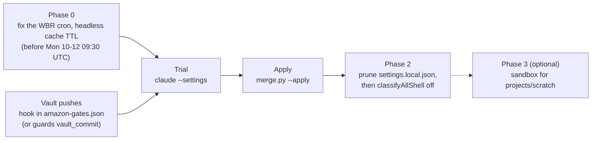

# settings/overlays

Host overlays for [`../merge.py`](../merge.py): the settings one machine needs on top of the generic templates. Today there is one host, an Amazon cloud desktop running Claude Code on Bedrock. Nothing here has been applied; `~/.claude/settings.json` is unchanged.

| File | What |
|---|---|
| `amazon.json` | Bedrock env, the four model pins, `awsAuthRefresh` (ada), `timeZone` and `STATUSLINE_TZ` (Europe/Luxembourg), `disableDeepLinkRegistration` (headless host), footer links for CRs and tickets, the AIM and cosmo marketplaces and their plugins. |
| `amazon-gates.json` | Ask rules for the Outlook, SharePoint and builder-mcp write tools, plus SES. Deny rules for `~/.midway`, the ShortLoad secrets and the 74 Slack write tools (already in the live file, so a no-op here; it rebuilds them on a fresh machine). The vault push hook ([`../hooks/`](../hooks/README.md)), `skillOverrides` and the `autoMode` block. Edit it directly. |
| `private.example.json` | The names of the confidential values the two overlays use, with placeholders. |

## Confidential values

The overlays are committed. The few values that must not be are `{{NAME}}` placeholders, filled from a gitignored values file passed with `--values`:

| Name | Used in |
|---|---|
| `AWS_ACCOUNT_ID` | `autoMode.environment`: the sanctioned Bedrock account. |
| `SHAREPOINT_SITE` | `autoMode.environment`: the team site among the trusted domains. |
| `REDSHIFT_SCHEMA` | `autoMode.environment`: the schema the reporting jobs write to. |
| `VAULT_PUSH_URL` | The vault hook's `--url`: the only push URL it approves. |
| `CODE_REVIEW_URL`, `TICKET_URL` | `footerLinksRegexes`: the link before the CR or ticket id. |

Copy `private.example.json` to `skills-amazon/settings/private.json` and fill it in. `skills-amazon/` is gitignored, `merge.py` warns if a values file in the checkout isn't, and `settings/tests/test_boundary.py` fails if any of its values turns up in a committed file of `settings/` or `statusline/`. Without the file, or with a value still reading `<...>`, `merge.py` stops before writing and names the missing value.

A gitignored file exists only in the checkout that has it. `shepherd finish` runs `git worktree remove`, which deletes ignored files with the worktree, so copy the values file to the main checkout first:

```bash
mkdir -p ~/claude-dotfiles/skills-amazon/settings
cp -a ~/claude-dotfiles-cc-operating-kit/skills-amazon/settings/private.json ~/claude-dotfiles/skills-amazon/settings/
```

## Merge order

```bash
cd ~/claude-dotfiles
python3 settings/merge.py \
  settings/user.template.json settings/gates.template.json \
  settings/overlays/amazon.json settings/overlays/amazon-gates.json \
  --values skills-amazon/settings/private.json \
  --override-key statusLine \
  --remove-key env.ANTHROPIC_CUSTOM_MODEL_OPTION \
  --remove-key env.ANTHROPIC_CUSTOM_MODEL_OPTION_NAME \
  --remove-key env.ANTHROPIC_CUSTOM_MODEL_OPTION_DESCRIPTION \
  --out ~/claude-settings-trial.json
```

- The generic templates come first, then the host overlays. Between overlays a later file wins a scalar conflict; today there is none (`test_overlays.py` checks).
- `--values` isn't an overlay: it only fills placeholders, so where it sits on the line doesn't matter. Given more than once, a later file wins.
- `--override-key statusLine` replaces the inline jq status line from 2026-08-25 (date, cwd, host).
- The three `--remove-key` flags drop the custom picker row. Once `ANTHROPIC_DEFAULT_OPUS_MODEL` is pinned, the picker already shows one row for the pinned model, so the custom option becomes a duplicate.

## Order of rollout



`amazon.json` alone (pins, env, footer links) can go in any time. `amazon-gates.json` must wait for Phase 0. `gates.template.json` (the push ask rules) must ship together with the vault hook, which is in `amazon-gates.json`, or vault pushes start prompting.

## Phase 0: the WBR cron, before any ask rule lands

Not done; do it by hand. The cron (`30 9 * * 1 ~/.claude/scripts/wbr-weekly.sh`) runs `claude -p --allowedTools "$allowed"` from workplace/SupplyChainAgents and loads `~/.claude/settings.json`. Rules are checked deny, then ask, then allow, and `--allowedTools` only adds allow rules. So once `amazon-gates.json` puts `email_send` and `sharepoint_write_file` under `ask`, every cron call to them hits a prompt nobody can answer, and is denied silently (a headless smoke test confirmed this for an ask rule on `git push`). The next run is **Monday 2026-10-12 09:30 UTC**.

- [ ] In `~/.claude/scripts/wbr-weekly-lib.sh`, `run_claude` (the `claude -p` call near line 233): add `--permission-mode auto --permission-prompts none`, so the mode is explicit instead of inherited. Add `--effort xhigh` too: a `-p` run reads `modelSettings` only for the model an entry names, and the live file has no entries until the apply, so today the cron runs Opus 5.5 at medium. And run it with `CLAUDE_CODE_PROMPT_CACHE_TTL=5m` in its environment: `promptCacheTtl: "1h"` applies to `-p` turns too, and a one-shot run pays the 2x 1-hour write rate for nothing.
- [ ] The same `CLAUDE_CODE_PROMPT_CACHE_TTL=5m` for ShortLoad's `operator.sh` (it has a monthly cost ceiling) and any other cron `claude -p`. `harnesses/autonomous-coding/loop.py` belongs to another track.
- [ ] Remove `mcp__aws-outlook-mcp__email_send` from `ALLOWED_WBR` (line 93). `ALLOWED_RETAIL` and `ALLOWED_D2D` (lines 94-95) inherit it.
- [ ] Switch `report-retail.sh` step 5 (line 38) and `report-d2d.sh` step 2 (line 32) from `email_send` to `mcp__aws-outlook-mcp__email_draft`. Both send on purpose today, so once the ask rule lands they would fail on Monday. `report-wbr.sh` already drafts (line 122).
- [ ] SharePoint publishing (`report-wbr.sh` lines 69, 86, 98). Pick one:
  - **(a) Retire cron publishing.** The cron writes `output/` plus drafts, and you publish. This also settles the cron collision noted in memory.
  - **(b) A cron-only settings file.** Pass `--settings ~/.claude/scripts/wbr-cron.settings.json` from `run_claude`. That file holds a `PermissionRequest` hook (matcher `mcp__amazon-sharepoint-mcp__sharepoint_write_file`) that prints `{"hookSpecificOutput":{"hookEventName":"PermissionRequest","decision":{"behavior":"allow"}}}` only when `tool_input` has siteUrl `https://` + `SHAREPOINT_SITE`, libraryName `Documents`, folderPath `WBR`, and a file name containing the run's `$WEEK`. Anything else gets `"behavior":"deny"` with a message. A headless smoke test confirmed that a PermissionRequest hook can answer an ask-rule prompt in a `-p --permission-mode auto --permission-prompts none` run.
- [ ] Run one branch by hand (the D2D one, say), then check its stream-json `result` event: `permission_denials` must be `[]`.

## Vault pushes

The memory note `feedback_vault_auto_commit.md` says: after every vault change, commit and push to `origin/mainline` without asking. Once `gates.template.json` lands, `Bash(git push *)` and `Bash(git -* push *)` ask before every push, and ask beats any allow rule. So every vault push would prompt in default and auto mode, and a headless run that pushes the vault would be denied silently. Two ways out:

- **The hook (in `amazon-gates.json`, the default).** [`allow_repo_push.py`](../hooks/README.md) with `--repo /local/home/pablomv/obsidian-vaults/vault`, `--url {{VAULT_PUSH_URL}}`, `--remote origin`, `--branch mainline`. It approves a plain add, commit and push of named vault files and nothing else; the hooks README lists exactly what passes. The URL pin matters here: `Bash(git *)` in `settings.local.json` allows `git config` and `git remote set-url` in sessions started in `~` until Phase 2.
- **The guards' `vault_commit` (opt-in, other component).** It commits the files Claude changed at the end of each turn and pushes from its own process, outside the Bash tool, so no rule applies. To use it, write `~/.claude/guards/config.json` with `{"vault_commit": {"path": "/local/home/pablomv/obsidian-vaults/vault", "remote": "origin", "branch": "mainline"}}`, and change the memory note to "don't commit or push the vault by hand": both together would double-commit. The hook can stay as a fallback.

**Replayed against real transcripts.** Between 2026-09-09 and 10-09, 10 Bash calls pushed the vault. Before the round-4 fixes the hook approved none of them (`2>&1`, `| tail`, `;`, `$V` and heredocs). Now it approves the 2 written as a commit-and-push of their own. 3 more bundle other work into the same call (a python heredoc, `sed -i`, `grep`); their commit-and-push part, run as its own call, is approved. The last 5 use forms the hook refuses even on their own: a `V=…; git -C "$V"` variable (2), `git commit -F - <<'EOF'` (2), and `git fetch && git rebase` (1). The fix is the memory note: with the shape below, 5 of the 10 would have been approved.

After a rejected push, a plain `git pull --rebase` isn't gated at all. Chained with the retry (`git pull --rebase && git push`), the hook approves it too.

## Trial

From the main checkout, after the track merges: the status line and hook paths must point at the main checkout, not a worktree. Run the [merge command](#merge-order), then:

```bash
STATUSLINE_CACHE_DIR=~/claude-dotfiles/skills-amazon/settings/trial-statusline \
  claude --settings ~/claude-settings-trial.json
```

- Add `--force` when you rewrite an earlier trial file; `merge.py` keeps a backup of it.
- `STATUSLINE_CACHE_DIR` keeps the trial's shepherd caches and log out of `~/.claude/statusline`. The status line process inherits it from the shell.
- In the trial, `--settings` lists are concatenated with the user file, so the 74 Slack denies appear twice. That's harmless.

## Apply

The same command with `--apply` in place of `--out …`. Before it writes, it prints the diff and one line per decision. Restart sessions afterwards so the `env` changes take effect.

`merge.py` checks that every `{{DOTFILES}}` path the result keeps exists. In `~/claude-dotfiles` before the track merges, `statusline/*.sh` or `settings/hooks/allow_repo_push.py` is missing: the preview and the trial print `warning: … doesn't exist`, and `--apply` refuses. Don't override that with `--force`; merge first.

Then check:

- `claude doctor`: Auto-updates `disabled (set by env: DISABLE_AUTOUPDATER)`.
- `claude auto-mode config`: environment 29 (21 defaults plus 8), soft_deny 74 (72 plus 2), hard_deny 2.
- `claude auto-mode critique`: costs a model call; read its notes on the two soft_deny rules.
- `/effort` on Opus 5.5 and Sonnet 5.5: `xhigh`; on Haiku 5.5: `medium`.

## Notes on amazon-gates.json

- **Tool names** come from transcripts. Ask rules with `_` or `*` in the tool name are exempt from the unknown-tool warning, so a typo would be silent: check a new name against a transcript before adding it. Two SharePoint tools the design missed, `sharepoint_remove_view_field` and `sharepoint_set_view_fields`, are covered by `sharepoint_remove_*` and `sharepoint_set_*`; `set_*` also covers `set_homepage`.
- `email_draft`, `todo_*` and `calendar_view` stay unprompted.
- **Datanet soft_deny.** The design wanted a DRY_RUN gate, but you pre-authorised the Reservoir/Datanet ETL workstream on 2026-10-06. The rule therefore only blocks live writes to ETL jobs you didn't name in the session and that aren't in the SCA serving-layer registry. Drop it if it gets in the way.
- **hard_deny** adds an explicit Amazon-data-off-network rule. The built-in Data Exfiltration rule stays (`$defaults`). Personal and hackathon projects aren't named in it, because user intent can't clear a hard_deny.
- **`classifyAllShell: true`** sends every shell command through the classifier while the 472 allows in `settings.local.json` are unpruned. Set it to false after Phase 2.
- **Not set:** `disableBypassPermissionsMode`, since you launch bypass mode and deny and ask rules hold there. Optionally `--remove-key skipDangerousModePermissionPrompt`, so entering bypass is a conscious step.
- **Not done here:** recipient and overwrite checks on the MCP tools. The classifier never sees ask-resolved calls, so those checks belong in a PreToolUse hook (the guards component).

## Phase 2: prune settings.local.json (by hand)

`~/.claude/settings.local.json` applies only to sessions started in `~`. Drop:

- the write-tool allows (`email_send`, `sharepoint_write_file`, `TicketingWriteActions`), which ask now outranks anyway;
- `Bash(git *)`, `Bash(curl *)`, `Bash(python3 *)` and `Bash(aws ses *)`;
- the 4 `sudo`, the 4 `rm -rf`, the PID kills and the 35 `/tmp` rules.

Run `/fewer-permission-prompts` only inside real repos, never in `~`: there the project settings file is `~/.claude/settings.json` itself. Then set `autoMode.classifyAllShell` to false.

## One-off cleanups on this host (from the audit; none done)

- [ ] **MCP duplicates.** From `~`, run `claude mcp remove <name> -s local` for builder-mcp, aws-outlook-mcp, datanet-mcp, redshift-mcp, diagram-tools-mcp and amazon-sharepoint-mcp. They are re-declared under `projects["/local/home/pablomv"]` in `~/.claude.json`.
- [ ] **Playwright.** `claude mcp add playwright -s user -- npx -y @playwright/mcp@0.0.83 --browser chrome --executable-path /home/pablomv/.local/chrome/opt/google/chrome/chrome --headless --no-sandbox`, then remove the `@latest` copies at local scope in `~`, scada-sim and uigen.
- [ ] **Second builder-mcp.** Disable the AIM plugins at user scope (`claude plugin disable AmazonBuilderCoreAIAgents-pipeline-assistant@aim --scope user`, and the same for `AmazonBuilderCoreAIAgents-runtime-configuration-assistant@aim`), re-enable them per Brazil workspace with `--scope local`, and re-check after AIM's next daily refresh. These commands come from the design's verifier; the build didn't run them.
- [ ] **Cloudflare skills.** Move the 11 dirs from `~/.claude/skills` into `projects/agentic-marketplace/.claude/skills` and `projects/haddock-cx-copilot/.claude/skills`. Both projects use Cloudflare, so don't delete them.
- [ ] **Commands listed twice (optional).** `install.sh` keeps the 14 `~/.claude/commands` links, so `/autobuild`, `/post`, `/resolver` and `/hs-*` work; the plugin lists each one again as `/claude-dotfiles:<name>`. To list them once and give up the short names, run `install.sh --plugin-commands-only` from the merged main checkout, and on every later run (see [plugin commands only](../README.md#optional-plugin-commands-only)). A run of the flag's cleanup on copies of the 14 real links, next to a user file and a link elsewhere, removed the 14 and kept the other two.
- [ ] **Deep-link handler.** `rm ~/.local/share/applications/claude-code-url-handler.desktop` (`amazon.json` sets `disableDeepLinkRegistration`).
- [ ] **Leftover trial caches.** `~/.claude/statusline/` holds three `shepherd-<session>` cache files and an empty log from the first build's trial runs (10-08). `rm -r ~/.claude/statusline` is safe.
- [ ] **Headless runs.** `harnesses/autonomous-coding/loop.py` (~line 396) needs `"--effort", "xhigh"` and `CLAUDE_CODE_PROMPT_CACHE_TTL=5m` in the child's env; that file belongs to another track. After the apply, `modelSettings` covers its Opus and Sonnet runs (checked headless for Sonnet), but not a Haiku run or a machine without the entries, so the flag is still the reliable way. `run_claude` (Phase 0) needs the same.
- [ ] **Vault memory note** (`feedback_vault_auto_commit.md`). If you switch to the guards' `vault_commit`, change it to say Claude no longer commits or pushes the vault by hand. With the hook alone, add the shape the hook approves, because the replay shows Claude bundling other work into the push call. Suggested text:

  > Commit and push the vault in a Bash call of its own, after the edits are done: `git -C ~/obsidian-vaults/vault add <files> && git -C ~/obsidian-vaults/vault commit -q -m '<message>' && git -C ~/obsidian-vaults/vault push -q origin mainline`. A trailing `2>&1 | tail -2; git -C ~/obsidian-vaults/vault log --oneline -1` is fine. Name the files: no `add -A`, `.` or folders, no `commit -a`. Put the message in single quotes, or use Claude Code's `-m "$(cat <<'EOF' … EOF)"` form; no `$` or backticks inside double quotes, no `-F -`. Don't put python, sed, grep, other repos or `V=…` variables in the same call. After a rejected push, run `git -C ~/obsidian-vaults/vault pull --rebase && git -C ~/obsidian-vaults/vault push`.

  What still prompts: `git rm`/`git mv` (use `git add <old> <new>`), a heredoc message with a line starting with `EOF`, `git fetch`/`git rebase`, and anything the note rules out. In a headless run each of those is a silent deny.

## What was verified (2026-10-08 and 10-09, CLI 2.1.294 and 2.1.295)

- **The documented apply on copies of the live `settings.json`.** The backup is byte-identical to the live file; every original leaf survives except the three removed `ANTHROPIC_CUSTOM_MODEL_OPTION*` keys and the replaced status line; the deny list goes from 74 to 99 with its order kept; top-level key order and the SessionStart hooks are unchanged; one PermissionRequest hook is added.
- **`claude --settings <trial> auto-mode config`** shows environment 29, soft_deny 74, hard_deny 2, with `$defaults` kept in each list.
- **Headless permission runs** (`claude -p`, Haiku 5.5, about $0.01 each, scratch repos with local bare remotes, allow rules added for every probe so each result also shows deny and ask beating allow):
  - Denied by a rule: `git push --force`, `git push origin +main` and its quoted forms, `--mirror` and `--mirr`, `cat .env`, `head ~/.ssh/known_hosts`, Read on `.env`. `git push origin main` hit the ask rule and was denied: no approval surface.
  - `curl -b ~/.midway/cookie …` still ran: the `~/.midway` Read deny doesn't break Midway curl.
  - The hook allowed the vault's add, commit and push shapes (plain, heredoc message, `2>&1 | tail; git log` suffixes) and gave no answer to `commit -qam`, `add ./`, `add -A`, a write after `;`, a push after `git config remote.origin.pushurl <other>` or `git remote set-url`, a push piped into `cat`, and `git diff <outside file> /dev/null && git push`. Each of those was denied, and the outside file's content appeared in no tool output.
  - The vault remote received exactly the approved commits, the other remotes nothing; the hook error log stayed empty.
  - The haiku alias resolved to `us.anthropic.claude-haiku-5-5`, and cache writes went to `ephemeral_1h_input_tokens`.
- **Effort, headless**, with the merged templates as user settings: Sonnet 5.5 ran at `xhigh` from its `modelSettings` entry, Haiku 5.5 at `medium`, as documented.
- **Interactive trial in tmux:** the status line rendered `Haiku 5.5 xhigh │ ctx 0%/400k │ ~$0.00 est │ ⎇ cc-operating-kit (track) │ 22:14:58`, ticking each second in Luxembourg time, so `env.STATUSLINE_TZ` from settings reaches the status line.
- **The hook:** 20 unit tests plus the lexer compared with bash 5.2 and zsh 5.9; `settings/tools/mutate_hook.py` catches 39 of 42 mutations (the 3 survivors are second layers whose cases the first layer already refuses); `settings/tools/fuzz_lexer.py 20000 4` found 0 mismatches in 3,080 compared commands.
- **The move to committed overlays (10-09, CLI 2.1.295):** the templates plus `amazon.json` and `amazon-gates.json` with `--values` merge to exactly what the earlier private overlays gave, apart from the hook's path. Re-run on the new pipeline: the apply on a copy of the live file (74 to 99 denies, no unexpected loss, no placeholder left), `auto-mode config` (29, 74, 2), and the headless smoke in default and auto mode ($0.012 and $0.009), whose trial was built by the merge command itself: 14 probes verbatim, the vault remote got exactly n1, n2 and n4, the redirected remote nothing, the outside file's token appeared in no output, and the hook log stayed empty. In auto mode the classifier also refused `git config remote.origin.pushurl <other>` itself.
- **Bedrock:** `list-inference-profiles` shows `us.anthropic.claude-{opus-5-5,sonnet-5-5,haiku-5-5,fable-5-1}`.
- **The auto-updater moved 2.1.294 to 2.1.295 at 20:04Z during this build.** That's the reason for `DISABLE_AUTOUPDATER`.
