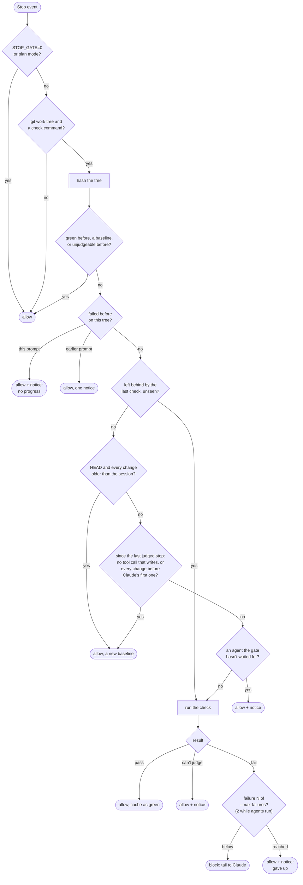

# How the Stop gate decides

`stop_gate.py` runs on two hook events. On **SessionStart** it records the tree the session started from. On **Stop**, which fires when Claude finishes a turn, it decides whether the turn may end. It uses only the standard library and needs Python 3.7+ and Claude Code 2.1.163+. It fails open: when it can't judge, it allows the stop and says why. It exits 0 on every path it controls, its own errors included; only its JSON reply blocks.

## Rules, in order

The first rule that matches decides. "Notice" is a `systemMessage`, shown to the user.

| Situation | Decision | Check run? | Who sees what |
| :- | :- | :- | :- |
| `STOP_GATE=0` (also `off`, `false`, `no`) | allow | no | nothing |
| bad stdin, or an event other than Stop/SessionStart | allow | no | nothing |
| `permission_mode` is `plan` | allow | no | nothing |
| no git work tree, or no check command | allow | no | nothing |
| tree hash already green in this session | allow | no | nothing |
| tree is a [baseline](#baselines): the session's start tree, or one adopted below | allow | no | nothing |
| the check couldn't judge this tree before | allow | no | nothing |
| same failing tree, same prompt | allow | no | notice: "nothing changed since the last failing check" |
| same failing tree, a later prompt | allow | no | one notice, then nothing |
| the tree is the one the last check left behind, and more than caches changed while it ran ([tree hash](#tree-hash)) | skip the next two rules | — | — |
| HEAD's commit and every path that differs from it predate the session ([checkouts, pulls, worktrees](#checkouts-pulls-and-worktrees)) | allow; becomes a baseline | no | nothing |
| since the last judged stop here, the transcript shows no tool call that can write files, or every path that changed did so before Claude's first such call ([someone else's changes](#someone-elses-changes)) | allow; becomes a baseline | no | nothing |
| a subagent, workflow or teammate runs that the gate hasn't waited for, and it hasn't waited in this prompt or on this tree (see **Background work** below) | allow | no | notice: "N background tasks … still running" |
| the state file can't be written (the gate writes it before running the check) | allow | no | notice: "can't write its state" |
| check passes | allow | yes | nothing |
| check passes and, as on its last run, rewrote the same untracked files ([tree hash](#tree-hash)) | allow | yes | one notice: "rewrites junit.xml on every run … Gitignore it" |
| check fails, below `--max-failures` this prompt | **block** | yes | Claude gets the last 21 lines or fewer, as "Stop hook feedback" |
| check fails, at `--max-failures` | allow | yes | notice: "still failing after N attempts — ERROR …" |
| check fails a second time in a prompt while a subagent, workflow or teammate runs | allow | yes | notice: "still fails while N background agents … run" |
| check fails, but the state can't be saved afterwards (the disk filled up meanwhile) | allow | yes | notice: "fails, but the gate can't write its state … ERROR …" |
| check exits 126/127 or `scripts/check` isn't executable, and the check has run in this work tree earlier in the session | **block** (a failure) | yes | Claude: "… it ran earlier in this session, so a change broke it" |
| the same, but the check hasn't run here yet this session; or it times out | allow | yes | notice: "check could not run …", "chmod +x scripts/check" or "timed out" |
| the gate's own error, or bad arguments | allow | — | notice: "internal error …", with a traceback in the log |

A check that dies from a signal the gate didn't send (a segfault, the OOM killer) has failed, the same as a non-zero exit. Only the gate's own timeout kill counts as "can't judge". `--max-failures` must be 2 or more: the gate blocks on failures 1 to N−1 and lets failure N through.

**How a block reaches Claude.** The gate prints `{"hookSpecificOutput": {"hookEventName": "Stop", "additionalContext": "<message>"}}` and exits 0. Claude Code keeps the turn going and shows the message as "Stop hook feedback". It applies the same loop protections as an exit-2 block, but shows no "Stop hook error" notice. Claude Code 2.1.163 added this reply; older versions ignore it, so there the gate never blocks. The message says the check fails on the current tree. It tells Claude to fix the failure, run the check itself, and say so plainly if the failure predates its work, came in with a checkout or pull, or needs the user. It then adds what applies:
- the files that changed since the last judged stop (up to 8 named);
- which of them changed before Claude's first tool call that can write, so they aren't its work;
- when none of them went through Claude's Edit, Write or NotebookEdit calls, that they may be someone else's work in progress;
- instead of the two hints above, when a background job Claude started has finished since: its command, and that what it wrote is Claude's work;
- that the work tree has changes Claude didn't make (uncommitted work at session start, or changes adopted as someone else's);
- which background agents are still running, and that Claude should wait rather than edit if the failure is in their files.

Claude Code caps the message at 10,000 characters, so the gate keeps it under 9,000. Each path it names is cut to its last 100 characters. If the message is still too long, lines go from the middle of the check's tail, then the list of changes. The tail's last line, the verdict, always stays.

The registered command turns an exit 2 from `python3` itself (it can't open the file) into exit 1, a non-blocking hook error. So only the gate's JSON reply can block.

**Background work.** Claude Code lists every in-flight backgrounded task in `background_tasks` (2.1.145+). That includes dev servers, file watchers, `tail -f` and Monitor streams, which never finish, and internal tasks that never touch the tree. So the gate waits only for `subagent`, `workflow` and `teammate` tasks: local agents that can still edit the tree and wake Claude when they finish. It waits once per task id, once per prompt and once per tree. The turn that starts an agent goes through with a notice. Every later stop is checked, even while that agent still runs, so a workflow that runs for hours can't wave through a string of edits. While agents run, though, a red tree may just be one they are half-way through. So:
- The block names the running agents and tells Claude to wait instead of editing if the failure is in files they are changing.
- The gate blocks at most once per prompt while agents run. A second failure in that prompt is let through with a notice. A wake-up from a finished agent can arrive as a new prompt, so a long workflow costs at most one extra turn per wake-up.
- A failure recorded while agents ran doesn't count as "the same failing tree" once none runs. The first stop after the last agent finishes, usually its wake-up, checks the tree again and blocks as usual.

Shell, monitor, MCP and cloud-session tasks never make the gate wait, and neither do scheduled wakeups (`session_crons`). What a shell, monitor or MCP job wrote counts as Claude's work once it has finished ([someone else's changes](#someone-elses-changes)).

**Which tree.** The gate checks the work tree that contains the hook's `cwd`, so a session inside a git worktree gates that worktree and its own `scripts/check`. If `cwd` is in a different repository from `$CLAUDE_PROJECT_DIR`, the gate checks the project instead. When `$CLAUDE_PROJECT_DIR` is a subfolder of its repository (a monorepo subproject with its own `.claude/settings.json`), the gate still hashes the whole work tree. It runs that subfolder's `scripts/check`, falling back to the one at the top, and reads `--watch` paths relative to the subfolder.

**Check command.** `$HARNESS_CHECK_CMD` comes first, then `--check CMD`, both run through the shell from the project folder. After that comes `scripts/check --fast` (or `--full`), run from the folder that holds it. The check runs in its own process group, with `STOP_GATE=0`, stdin closed, and stdout and stderr merged. The gate cleans the output (ANSI codes and progress-bar frames removed, lines capped at 300 characters) and keeps the last 21 lines: the contract's 20 summary lines and its last line. The error line in notices is the last line that starts with `ERROR` or `CHECK FAIL`, or failing that, the last non-empty line.

## Tree hash

The hash identifies what is on disk, not the commits. It covers two things:
- Every tracked path whose content differs from the **base**, the tree HEAD had when the session first saw this work tree. They come from `git diff-index <base>`.
- Every untracked, non-ignored path, from `git ls-files --others --exclude-standard`.

Each path counts by its mode and git blob id. So committing, staging, touching a file and `git commit --allow-empty` leave the hash alone, while an edit, a new file, a deletion, a mode change, a checkout or a pull change it. Touching has two exceptions: a tracked file over the read budget (below), and one whose bytes on disk differ from its blob through eol conversion (`eol=crlf`) or a clean/smudge filter such as Git LFS. Touching either counts as a change until something refreshes the index, as `git status` does. That costs a check run, never a missed failure.

`diff-index` is plumbing: it never refreshes the index, and it reports a file whose stat info changed (a new mtime, maybe with the same bytes) without reading it. The gate reads those files itself and drops the ones whose bytes still match the base. Reading has a budget: files up to 1 MiB, 16 MiB and 1,000 files per hash. A file over 1 MiB, or anything past the budget, counts by size, mtime, ctime and inode instead. So a 300 MB data file costs one `lstat`, not a read, and a rewrite in place shows even when the mtime is put back.

A dirty submodule, or an untracked nested repository, is hashed the same way, recursively and up to three levels deep. `--ignore-submodules=none` overrides any `ignore` setting in `.gitmodules`. A worktree of the same repository inside the tree, such as `.claude/worktrees/<name>`, isn't part of it: it is gated on its own when Claude works there. `--watch PATH` limits the tracked and the untracked part to those paths. The paths must be inside the repo, and they can't reach into a submodule. Ignored files are invisible: a change that only touches ignored paths, such as generated data or build output, doesn't trigger the check. The gate runs git with `GIT_OPTIONAL_LOCKS=0`, so it never takes `index.lock` behind Claude's back.

The gate hashes the tree again after the check runs, because something may have written while it ran: the check itself, a background job, an agent or an editor.
- **A pass** covers the new tree too only when no background task runs and every untracked path that changed is a check by-product: anything under `__pycache__/`, `.pytest_cache/`, `.mypy_cache/`, `.ruff_cache/`, `.hypothesis/` or `node_modules/.cache/`, a `*.pyc` or `*.pyo` file, a `.coverage*` file, or a file this check was seen to rewrite on every run (below). A new module or test written meanwhile isn't covered: the check never saw it.
- **A failure** covers the new tree when only untracked files changed. That way a log line written meanwhile can't turn a failure Claude already reported into a fresh block.
- **Anything else** leaves the new tree unjudged: a tracked change (a formatter in the check, an editor, an agent), or other untracked files after a pass. The next stop on exactly that tree runs the check, skipping the baseline rules, so a change the check didn't see is never adopted as someone else's.

A check that writes a report it doesn't gitignore (`pytest --junitxml`, `coverage xml`) leaves an unjudged tree after every pass, so the next stop runs it again, even on a question turn. When that run passes and changes exactly the same untracked files again, with no background task running, the gate takes them as the check's own output. It tells the user once ("rewrites junit.xml on every run … Gitignore it"), and from then on treats them like caches, for that work tree and session. That costs one extra run per session. A report with a new name on every run (`test-results/run-<pid>.xml`) can't be told apart from new work: every stop runs the check again, and the user is told once. Gitignore whatever the check writes (`junit.xml`, `coverage.xml`, `htmlcov/`, `test-results/`, build output).

## Loop guard

The docs say `stop_hook_active` is `true` "when Claude Code is already continuing as a result of a stop hook". In 2.1.294 it stays true for the rest of the prompt after any Stop hook blocks, and that includes the `/goal` evaluator's "not met". Headless runs confirmed both:
- After a gate block, the next Stop still had `stop_hook_active: true` even though four tool calls came in between.
- In a three-turn `/goal` run where the gate never blocked, turns 2 and 3 arrived with `stop_hook_active: true`. All Stops carried the same `prompt_id`.
- In 2.1.295, the stop after an `additionalContext` reply also arrived with `stop_hook_active: true` and the same `prompt_id`.

A gate that allows whenever the flag is set would therefore run at most once per prompt, and do nothing at all during a `/goal` run. So the gate counts failures per `prompt_id` instead. It falls back to `stop_hook_active` only when `prompt_id` is missing, which happens before the first user input.

Within one prompt:
- The gate blocks on failures 1 and 2. On failure 3 (`--max-failures`), it allows the stop and tells the user. While a subagent, workflow or teammate runs, it blocks on failure 1 only ([background work](#rules-in-order)).
- If Claude ends a turn without changing the tree since the last failure, the gate allows the stop immediately with a "no progress" notice. Claude is either stuck or reporting a failure it can't fix.
- A pass, or a return to a tree that was green, ends the streak and resets the count.

Claude Code's own cap still applies as the backstop: after 8 consecutive continuations with no tool call in between, it overrides the block (`CLAUDE_CODE_STOP_HOOK_BLOCK_CAP`).

## Baselines

A baseline is a tree the gate knows isn't Claude's work. It is never checked, and a stop on it is allowed silently. There are three ways a tree becomes one.

**The start tree.** The installer registers the gate on SessionStart (`startup|resume|clear|fork`). On a new session it records the base tree, the tree's hash, whether it had uncommitted changes, the time, and where the transcript ends. This covers the user's own half-finished, red changes, a new session opened on a red branch, and committing that work at the user's request. The other sources:
- **`compact`** keeps everything: it is the same session doing the same work.
- **`resume`** of a work tree the session already judged keeps everything too: no new baseline, and the stored start time, base and transcript mark. A turn can end without a Stop (Esc, a crash, a killed run), and its edits are then still unjudged. The first stop after the resume reads them in the transcript and runs the check. Resuming a session the gate has no state for (installed since, or the state expired) records the tree like a new session.
- **`fork`** is a copy of the conversation in a new session: `/fork`, `/branch`, `/background`, "Move to background and exit", or `--resume … --fork-session`. It records no baseline and no start time, and its mark is the top of the copied transcript, so Claude's edits from before the copy are judged at the first stop. The cost is one check run when the copied conversation has any tool call that can write; on the user's own red work, that is one block. In a fork the checkout rule stays off.
- **`clear`** starts over like a new session: the tree is a baseline, including any edits of Claude's that no stop judged.

`--no-baseline` drops the handler. Then the first turn of every session runs the check, the [checkout rule](#checkouts-pulls-and-worktrees) stays off for the whole session because it needs the session's start time, and the [someone-else rules](#someone-elses-changes) turn on after the first judged stop.

### Checkouts, pulls and worktrees

A tree also becomes a baseline when both of these hold:
- HEAD's commit time is before the session started.
- Every path that differs from HEAD, tracked or untracked, was last changed before the session started, by its ctime. A deletion, or a nested repository, counts as new.

ctime is set by the kernel on every write, rename or chmod, and only a clock change can set it back, so copying with `cp -p` or `touch -d` doesn't make a new file look old. Paths changed less than a second before the session started count as new.

This covers:
- checking out a teammate's branch to read it, a fast-forward pull, and `git stash`;
- a worktree first seen mid-session (EnterWorktree, a shepherd track, `git worktree add`), clean or with work that another session left there earlier.

A commit made during the session doesn't qualify, so editing and committing red work in one turn is still gated. Neither does a new untracked file, so a new module Claude writes in a fresh worktree is checked.

### Someone else's changes

A dev server appending to `dev.log`, an editor's swap file, or the user's own edit between prompts changes the tree on a turn where Claude may have changed nothing. The gate reads the transcript (`transcript_path`) from the point where it last judged this work tree, and adopts the tree as a baseline when either of these holds:
- **No tool call that can write.** The transcript shows none up to this turn's final message. Read, Glob, Grep, LSP, WebFetch, WebSearch, the task list tools and a few others can't write. Any other tool call can: Bash, Edit, Write, NotebookEdit, Agent, Skill, MCP tools, and any name the gate doesn't know. So can a content block it doesn't know, or a subagent's sidechain entry.
- **Every change came first.** Each path that changed since that judged stop did so after the stop ended and more than a second before the user entry (the prompt, or a tool result) just before Claude's first tool call that can write. Paths are dated by the later of their ctime and mtime. The gate remembers the judged tree's changed paths (up to 500) to find which changed since, and it compares their times with the transcript's `timestamp` fields; both come from the same machine's clock.

This matters on Linux, macOS and WSL. There Claude Code leaves Glob and Grep out by default, so Claude searches with `grep` and `find` through Bash, and a question turn usually has a Bash call. Without the second rule, every such turn after the user saved a red edit would block.

Both rules count positive evidence only:
- Each needs the transcript from that judged stop on: a regular file of JSON lines, with no more than 16 MiB written since. Without one (`--no-session-persistence`, or a long stretch of turns since the last judged stop), the check runs.
- The first needs the transcript to reach this turn's final message (`last_assistant_message`). Claude Code appends that message about 0.1 s after Stop hooks start (2.1.295), so the gate polls for up to a second. Without it, the check runs.
- The second needs every changed path to be datable. A deletion, a nested repository, a path that turned up with an old time, a change made during the last judged stop (while its check ran, say), more than 500 changed paths, or an entry without a timestamp each make the check run.
- Any subagent, workflow or teammate running now, or at that last judged stop, rules both out, because their edits aren't in this transcript.
- If any background task (a dev server, a watcher) is running now or was at that stop, a change to a tracked file rules both out, because Claude may have started the job that wrote it.
- A background job Claude started (a `run_in_background` or Ctrl+B shell command, a monitor, an MCP task) writes after the turn that started it has ended. Once it has finished, what it wrote is Claude's work, though no tool call in the wake-up turn wrote it. So when a job that ran at a judged stop has left `background_tasks`, and the untracked part (caches left out) changed since the gate first saw the job, both rules are ruled out. A tree taken as someone else's while the job still ran, with untracked changes, is a baseline only until the job ends. A job that keeps running (a dev server, a watcher) keeps the tolerance for untracked changes such as its log.

The upshot for a tree that was already red, such as the user's uncommitted work: a question turn doesn't block when the user's last edit came more than a second before the prompt, whether Claude read with Read, Grep or a Bash search. A turn that also changed the tree while it ran blocks once (a dev server's log written mid-turn is enough). The message lists the changed files, names those that changed before Claude's first tool call, and says when none went through its Edit or Write calls. When Claude says the failure isn't its own without changing anything, the next stop goes through.

## Files

| Path | What |
| :- | :- |
| `~/.claude/verify-gate/state/<session_id>.json` (`$CLAUDE_CONFIG_DIR/verify-gate/state/` if set) | Per-session state: the session start time, the last 16 baselines, the last 8 green hashes, the last failure, the prompt counter, the agents already waited for and, for each of the last 8 work trees, its base tree, whether its check has run, the tree the last check left unjudged and what changed in it, the files the check rewrites on every run, the background jobs seen running (each with the untracked part when first seen, and the trees taken as someone else's while it ran), and its last judged stop: where the transcript ended, the judged tree's changed paths and when it was hashed. A file of the wrong shape is replaced. Files idle for 14 days are deleted when a new session starts. |
| `~/.claude/verify-gate/stop_gate.log` (same folder rule) | One line per call: event, session, reason, `allow` or `block`, ms, work tree, subproject, prompt, `stop_hook_active`, background task types, check seconds, why a tree was taken as someone else's (`by=transcript` or `by=time`), background jobs that ended (`jobs_ended=N`), files learned as the check's output (`outputs=N`) and state write errors (`state_error=`). Cancellations are logged as `cancelled`. Rotated at 512 KiB to `.log.1`. |

## Cost

These times cover a turn whose tree is already judged. They are measured end to end on Linux: Python start-up and imports (about 33 ms of the total), the git calls, the state read and write and the transcript's tail.

| Repo | Per stop |
| :- | :- |
| a small repo | 61 ms |
| 5,000 tracked files and 300 untracked ones | 87 ms |
| 60,000 tracked files, clean | 143 ms |
| a 200 MB tracked CSV or a 300 MB binary with a small edit | 56 ms |
| 440 untracked files totalling 430 MB | 77 ms |
| 20,000 tracked files with touched mtimes | 367 ms |
| 60,000 untracked, non-ignored files | 530 ms |

The first two rows were measured with the current gate; the others with the previous version, which lacked the path list in the state (2–3 ms on the second row). Most of the last two rows is one `lstat` per file, about 5 µs each on this machine. Ignore generated trees, or use `--watch`, to keep them out. A turn that changed the tree also costs a git call and an `lstat` per changed path for the baseline rules, up to a second of waiting for the transcript when Claude used no writing tool, and then the check's run time plus a second hash. A question turn after the user's edit, answered with a Bash search, took 69 ms on the small repo and 97 ms on the second one, with no check run.

## Limits

- Needs Claude Code 2.1.163+ for the block reply and 2.1.145+ for `background_tasks`. On older versions it never blocks, without any sign.
- Subagents aren't gated on their own (`SubagentStop` isn't registered). Their edits are gated when the main turn ends.
- The gate trusts `scripts/check`. A check that passes on a broken tree lets the stop through. The `/goal` constraints ("no test file is modified") and code review cover that gap.
- `scripts/check` must not stash, reset or rewrite the user's work, or hold `index.lock`. A check killed halfway (the timeout, or Claude Code cancelling the gate) may not get to put things back. Nor should it rewrite tracked files: run formatters in their check mode. A tree the check reformatted is checked again on the next stop.
- The timeout kills the check's whole process group: SIGTERM, then SIGKILL 2 s later. The installer sets the hook's `timeout` to the check timeout + 60 s, so Claude Code doesn't cancel the gate first. If Claude Code does cancel it (SIGTERM, SIGINT or SIGHUP), the gate sends the check SIGTERM, gives it a second to clean up, then SIGKILL; it logs `cancelled` once and allows the stop. The gate holds those signals while it starts the check and its watchdog, so a cancel that lands right then still takes the check down. A SIGKILL can't be handled, so a forked watchdog, which ignores those signals, kills the check's group when the gate dies without releasing it. A SIGKILL can't be held either: one that lands in the instant between starting the check and forking the watchdog leaves the check running. The hook timeout is 60 s longer than the check's, so it can't expire at that moment.
- A process Claude detached itself (`nohup … &` rather than a background task) is invisible to the gate. What it writes later counts as someone else's. So do untracked files a background job writes while it keeps running, until it ends. When a long-running job does end (a dev server the user stops), the next stop runs the check if its log or any other untracked file changed while it ran; on the user's red work, that is one block.
- The "every change came first" rule trusts the machine's clock. It allows 20 ms for file times lagging the clock, or a full second on a filesystem with whole-second times, and a second before Claude's first call. A clock stepped back during a session can misdate a change.
- Paths marked `git update-index --assume-unchanged` or `--skip-worktree` are invisible: `diff-index` trusts the index for them, so editing one doesn't change the hash.
- [Someone else's changes](#someone-elses-changes) relies on the transcript's format (one JSON entry per line, `tool_use` blocks with a `name`) and on Claude Code writing entries in order. A format the gate doesn't recognise makes it run the check.
- The registered command is POSIX shell and needs `python3` on `PATH`. When the hook file is missing or unreadable, or there is no `python3`, the command allows the stop silently. On Windows, Claude Code runs it under Git Bash. Without Git Bash, it falls back to PowerShell, which can't parse the command, so each Stop and SessionStart shows a hook error notice. The gate itself is untested on Windows. Without process groups, the timeout and a cancel kill only the check's own process, not its children. Windows also can't start `scripts/check` directly, so every stop is allowed as "could not start" unless the installer gets `--check "bash scripts/check --fast"`; it prints a note saying so.
- A repository at a path that isn't valid UTF-8 is gated like any other.
- Tested on Linux with git 2.50, Python 3.9 and Claude Code 2.1.295.
