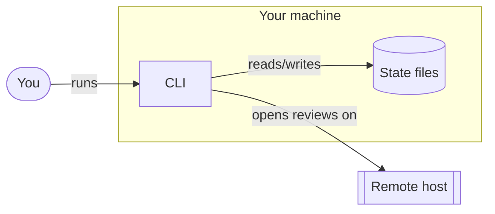
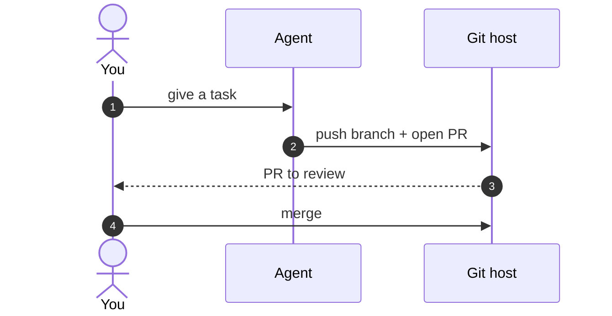
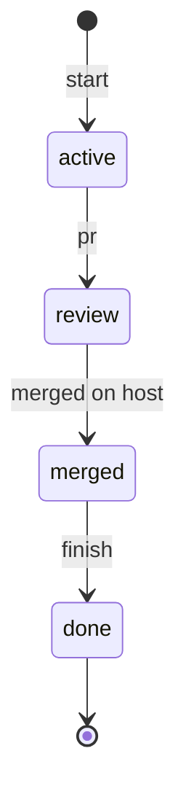
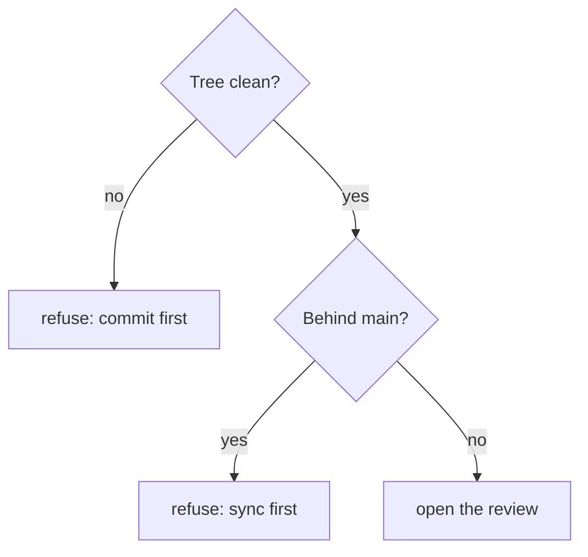

# Mermaid diagrams that render (and read) on GitHub

GitHub renders fenced ` ```mermaid ` blocks in Markdown, issues and PRs, in light and dark themes, with interactions disabled. Its Mermaid version lags the latest release, so stick to the diagram types below.

## Pick the type by the question

| The reader asks… | Diagram | Notes |
|---|---|---|
| What are the parts and what talks to what? | `flowchart LR` with `subgraph`s | Architecture. Group by process or boundary, not by file. |
| What happens, in order, between actors? | `sequenceDiagram` | A walkthrough of one scenario. `autonumber` when the prose refers to steps. |
| What states can X be in, and what moves it? | `stateDiagram-v2` | Lifecycles (tracks, orders, jobs). Label transitions with the command or event. |
| How is this decision made? | `flowchart TD` with `{diamonds}` | Rules, guards, pre-flight checks. One decision path per diagram. |
| How do the records relate? | `erDiagram` | Data models and state files. |
| How do branches and merges flow? | `gitGraph` | Branching workflows. |

Don't draw: a linear list of three steps (use a numbered list), anything a table says better (options, flags, mappings), or a diagram of the folder tree (use a code block).

## Rules for GitHub

- `flowchart`, not `graph`; `stateDiagram-v2`, not `stateDiagram`.
- No `click`, no callbacks, no links inside nodes — GitHub strips them.
- No `%%{init: …}%%` themes or hard-coded fill colours: GitHub picks light or dark per viewer and fixed colours break one of them. If emphasis is essential, use a `classDef` with a mid-tone fill *and* matching text colour, and check it in both themes.
- Node ids: short and alphanumeric (`cli`, `hooks`, `gh`). Never the bare word `end` (it closes subgraphs); avoid `graph`, `style`, `class`, `default` as ids.
- Quote labels that contain punctuation: `A["state in .git/shepherd/ (shared)"]`. Inside quotes, write `#quot;` for `"` and `<br/>` for a line break. In `sequenceDiagram` messages, avoid `;` and `#` (write `#59;`, `#35;`).
- `erDiagram` entity names: no spaces or dots (`TRACK`, `LOG_ENTRY`); attributes as `type name`.
- `gitGraph`: `commit`, `branch x`, `checkout x`, `merge x`; a branch must exist before checkout.

## Rules for reading

- **One idea per diagram, ≤ 15 nodes.** Two ideas → two diagrams. A diagram that needs a legend is two diagrams.
- **Same names everywhere**: the label in the diagram is the word in the prose and the name in the code (`track`, `review`, `shepherd pr`).
- Nouns in nodes, verbs on edges (`-- "opens" -->`).
- Direction: `LR` for pipelines and architecture, `TD` for decisions and hierarchies.
- Shapes carry meaning, consistently within a doc: `[process/component]`, `[(stored state)]`, `{decision}`, `([actor or start/stop])`, `[[external system]]`.
- Introduce each diagram with the question it answers; follow it with only what the picture can't show.
- **Tangled render → split it by question** (who calls what / what writes what) before fiddling with layout. Then, if needed: a `TD` chart with `direction LR` inside each subgraph gives clean rows; node order in the source sets left-to-right order.
- A chain where every check either stops or continues is a numbered list or table, not a flowchart.

## Templates

Architecture:



Walkthrough:



Lifecycle:



Decision:



## Checking

`python3 "${CLAUDE_SKILL_DIR}/scripts/check_docs.py" <paths> --png <dir>` renders every block with mermaid-cli (needs Node; the first run downloads it), reports parse errors as `file:line`, flags the GitHub rules above that can be checked mechanically, and writes PNGs. Rendering proves the syntax; only looking at the PNG proves the diagram reads.
